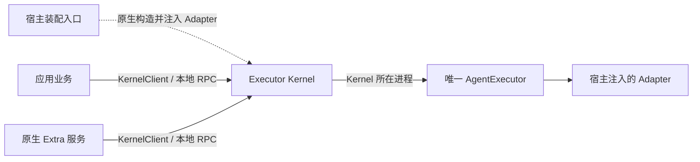

# 本地执行与传输

服务构造遵循 [#294 原生装配与统一 RPC](architecture.md#sdk-原生装配与统一-rpc)：CLI 服务进程与 Electron 主进程原生构造服务并持有 endpoint，注入实际 Adapter；同进程业务也必须通过 KernelClient/RPC。Kernel 不读模块 manifest、不启动执行 worker。本任务工作树已切换为原生对象装配。RPC、接纳、观察和清理合同继续有效，目标签名见[架构声明](architecture.md#createkernelservice-目标签名)。直接 Core 是显式低层能力，不替代标准宿主的 Kernel 路径。

业务输入为 InvokeInput，环境 signal 不序列化，executionEnvOverrides 独立传递。唯一 Core 负责执行配置解析和输入准备；Extra 不提前解析内部计划，不补模型历史。

App 的 attached client、原生服务的 client 和 Extra 的 ctx.kernel 都直接使用 KernelClient.invoke(input, environment?)，普通消费者不组合 submit/subscribe。业务仅调用 RPC 能力，不负责服务托管、调用登记或手动 drain。首次 next 才自动登记和提交；native/default 返回 HostFrame，canonical 返回 CanonicalEvent，变量模式返回联合。没有 Extra 加载要求，也没有第二个 Extra invoke。高级调用方保留原语并自行管理其所有权。

caller signal 在写出前取消时不发 invoke；写出后按原身份恢复接纳并发一次 cancel，原观察保留尾事件。正常耗尽后抛实际 signal.reason，具体传输/控制错误优先保留。iterator.return/client.close/订阅 signal 只关闭观察。native lost 先保留源帧再报 RUN_OUTCOME_UNKNOWN；canonical 在错误处查询确认 lost 后报同码，不造 Provider 事件。若确认查询失败，保留原控制错误。

invocations 只登记本 client 的高层 invoke 元数据，最多 128（包括在途/未知）。cancelInvocation/respondInteraction/respondNativeInteraction 按 invocationId 关联原 ref；非本 client 登记拒绝。owner 先 stopAdmission，再 drain({deadline,reason})，使用绝对共享期限；重复排空共享首次操作，最多 4 查询和 4 取消并发，不增加重放订阅。确认 completed/failed/cancelled 才释放登记，lost/未知/未确认仍返回 unresolved，不能把 ACK 当完成。低层 submit 不进入登记。

environment.streamLimits 在现有 Kernel wire 不支持，显式传入拒绝 KERNEL_STREAM_LIMITS_UNSUPPORTED；直接 Core 仍支持。执行终态与 delivery/业务写入完成分别验证，SDK 继续等待 onDispose 的剩余期限。当前实现和证据见 [#69 实施](../tasks/69-kernel-client-invoke/implementation.md)。

Kernel 宿主的 configurations 回调每次提交尝试只读取一次，按本轮 runtimeId 和 Adapter 选择配置；Provider 选项与流限制使用同一份经校验的自有快照。宿主选项仍覆盖输入同名项，合并后检查整请求预算，再传给执行源和重放窗口。更新原配置不影响在途 AgentRun，后续 AgentRun 独立读取；list/probe 独立取值，订阅、重放、取消和交互不重新读取本轮配置。框架不冻结宿主原对象，不持久化或按会话复用配置快照。实现与显式本地专项见 [Issue 136 验证](../tasks/136-configuration-snapshot/validation.md)。

## IPC v1

一条连接发送一条 UTF-8 LF 结尾 JSON-RPC 请求，不接受 batch。status/list、invoke/get/subscribe/cancel/respond/native.respond 形状由 [wire Schema](../../packages/octo-runtime-protocol/schema/kernel-ipc.schema.json) 定义。共享 [protocol Schema](../../packages/octo-runtime-protocol/schema/protocol.schema.json) 定义 LookupKey、RunRef、Snapshot 和 Status；主包公开原始 JSON。

- submit 返回完整 RunRef：kernel_instance_id 加原 receipt 的所有身份。
- get 使用 run/invocation/session/generation/mode 五元组，允许指定预期 Kernel instance。
- 订阅和控制校验完整 ref。游标是最后连续收到的 seq。
- wire invoke 与 subscribe 分离；普通业务 API 使用 main 已实现的同一个 KernelClient.invoke。接纳后 Kernel 独立消费源，不由请求 socket 拥有 generator。
- ACK 丢失仅查询原身份，最多 3 次、总修复预算 10 秒；不能重新 invoke。
- 断流沿原 ref/cursor 有界修复，实例变化、身份不符、窗口缺口和过期明确失败。
- cancel/respond 的 ACK 仅表示操作被接纳；执行结果以真实终态为准。
- 连接、客户端 close、iterator.return 或订阅取消不等于业务 cancel。
- 控制 ACK 丢失返回 OPERATION_OUTCOME_UNKNOWN，不自动重试副作用。

同一取消尝试的并发 Stop 共享在途请求。控制失败后，仅新的公开 `cancelInvocation` 显式调用可对原 RunRef 发起新尝试；drain、signal 与接纳 ACK 接续不能自动重试未知结果，更不能重新 invoke。原 invoke 观察链保留首次取消尝试的真实结果，不能因后续显式 Stop 成功而覆盖原控制失败。专项见 [Issue 302 任务](../tasks/302-explicit-stop-retry/brief.md)，保持显式手动执行。

本地 IPC 同一 OS 账号互信；不增加 APP 注册、共享 Token 或逐应用授权。POSIX socket 权限为 0600；Windows Pipe 的访问机制独立，不能由 POSIX 结果推断。远程入口的授权归 Extra 和业务系统。

### Playboard 临时端点与常驻 Home

常驻 POSIX socket 保留在宿主配置的 Runtime Home 内；SDK 要求宿主显式提供并准备已存在的绝对 Home；CLI 所有平台统一 `--home` 或用户 `~/.octo-runtime`，不保留额外环境覆盖，见 [#306 合同](runtime-lifecycle.md#runtime-home-所有权与启动校验)。一次性 Playboard 的 POSIX socket 则在固定短根 `/tmp` 下以 `mkdtemp` 创建本次独占的私有目录，使用短文件名；不能把受 TMPDIR/TMP/TEMP 影响的长或多字节路径继续拼进 Unix socket。Windows Playboard 保留系统临时目录与既有哈希命名管道。

Playboard 直接构造临时 Kernel，只有真实 close 完成才删除所属目录；incomplete 时保留资源事实，不删除其他实例或用户 Home。创建临时目录失败时尚未注册进程级监听，不能留下 signal/stdout handler。#184 的临时 IPC 修复不迁移常驻端点、不改变公共 SDK、不新增 Home 限制；#306 的 Home 输入合同独立见上述链接。临时 IPC 验证与范围见 [Issue 184](../tasks/184-ci-ipc-reliability/brief.md)。

## 原生执行与故障边界

Kernel 在宿主进程构造 AgentExecutor，注册传入实例；不启动执行 worker，不提供心跳、退避替换、generation 或 worker.recovery 状态。status 仅报告当前实例、宿主 PID 和 execution_ready；注册就绪不证明 Provider 安装或登录成功。

RPC 保留接纳、观察分离、ACK 查回、原游标恢复和取消/交互。宿主退出后不能把结果未知改成成功，也不自动重新 invoke；宿主重建服务产生新的 instance。Kernel 不改变进程信号处理、不调用 process.exit、不改全局环境。Adapter 内部按 Provider 原生协议拥有子进程。

关闭停止接纳、取消 Core，并在共享 5 秒绝对期限内等待 Adapter 清理、Run 消费和日志。未完成/失败的 finally 返回 incomplete，保留所有权证据；同进程同步阻塞、OOM 或进程退出无法靠 RPC 隔离，截止时间要求事件循环仍可调度。宿主依赖仍由宿主关闭。

已发起的实际 Adapter probe 同属 Core 生命周期；describe 的展示超时不结束底层 Promise。关闭后拒绝新 probe，未完成探测使 cleanup incomplete，即使没有遗留 invocation 身份。原生服务实际关闭失败写入 cleanupFailed，诊断不能因 Electron 宿主仍活着而显示 available；活 owner 的人工确认继续拒绝。

Kernel 在 runs.submit 前明确拒绝接纳时可以附带匹配 instance 的未提交证据；ACK 丢失或接纳后失联仍是未知。状态码名称、重建错误对象均不能代替该证据。

旧 worker 监督与恢复的历史实现见 [Issue 210](../tasks/210-kernel-recovery/design.md)，不得重新用作当前服务部署要求。

## 有界资源

源窗口沿中央 StreamLimitPolicy：默认每 Run 4096 帧 / 32 MiB，全局 128 MiB / 128 Run、终态 TTL 120 秒。Kernel 最多 64 连接 / 16 订阅，客户端最多 32 个在途连接。写入等待 drain 最多 5 秒；接收行使用中央 HostFrame 上限，invoke 使用中央 32 MiB 上限。客户端按异步消费施加背压，不增加无界事件队列。

POSIX 只回收自己创建的独立进程组，leader 退出不表示后代消失；TERM 400 ms、KILL 确认 200 ms 共用起点，EPERM 不是消失证明。spawn/stdin/stdout/stderr 错误只归属本次调用，不能中断兄弟调用；异步启动失败须保留原 errno，不能因尚无 PID 而提前清理未启动的句柄。

Windows 使用 Node.js 创建进程，并通过系统已有的 `taskkill /PID … /T /F` 处理仍可识别的进程树。ChildProcess、status 和 manifest 保留真实目标身份。父进程先退出后可能失去后代归属；Runtime 被强杀或事件循环无法运行时，退出回调也可能不执行。这些场景不具备 Job Object 级回收保证。现有清理在 leader 已退出时仍可能返回成功，因此 cleanup.complete 不是异常退出后整棵树已清空的证明；对应缺口保留，不以文档修改宣称已经修复。

Kernel 资源记录仅接受原生 owner 格式。旧 worker 格式或损坏记录返回 ORPHAN_RECORD_UNSUPPORTED 并保留原文件；不做身份探测、进程树终止、转换或自动删除。inspect 显示 unsupported，人工确认也不接受未知格式。旧 worker 监督、心跳及恢复实现全部删除，不提供兼容或升级支持。Provider 进程清理仍由 Adapter 负责。

JSON-lines Provider 的 stdout、stderr 及 readline 错误归属单次调用，走相同有界清理路径；迟到的管道 error 仍有监听。进程清理后释放所属 stdin/stdout/stderr，失败继续传播；释放句柄不是进程已退出的证明。Windows 原生启动失败保留 ENOENT 等原始 errno，不用全局异常抑制或重启共享 worker 消化本次管道错误。

ACP 的原生 spawn 错误在本轮 transport close 成功后，以保留原 errno 和消息的 `run.failed` 结束，再由 Core 验证迭代器耗尽与关闭。不能把已清理的启动失败继续作为读取拒绝交给 Core，造成未确认 owner；也不能以此放宽 Core 对任意 next 拒绝或 finally 失败的保守处理。close 失败继续传播，其他结构化错误保持原有合同。显式手动回归和版本绑定证据见 [Issue 236](../tasks/236-windows-acp-cleanup/brief.md)。

确认被消费并创建新清单或正常 close 后，尽力删除已经失效的 acknowledgement 辅助文件，原始 acknowledged 归档继续保留。辅助文件清理失败不得将已恢复的启动重新阻塞；它已不能匹配新清单。CLI 的 --manifest 选择 Provider/Extra 模块清单，不改变 Home 下的 Kernel 状态位置，doctor、recover 与前台 Kernel 共用该位置。

公共 Runtime 不引入 Go broker、原生扩展或随包辅助二进制，遵守[实现语言与原生依赖边界](architecture.md#实现语言与原生依赖边界)。已观察到的清理失败及协议未确认仍按既有合同报告 incomplete。各 Windows 平台及真实 Provider 的验证证据分别记录，历史原生方案的测试结果不能作为当前 Node.js 方案的回收保证，见[专项实施记录](../tasks/gateway-drain-windows-cleanup/implementation.md)。

## 临时执行与证据

CLI playboard 通过同一原生工厂在本进程创建临时 Kernel 服务，读取选定 profile 的 Provider 配置，跳过 Extra 和渠道工具环境同步。正常结束只回收本次资源，保留 Home/profile，不复用常驻服务。只有确认 close 完整，才删除本次临时目录。

2026-11-02 用户明确 Playboard 仅为一次性本地测试 CLI：可执行入口确认命令后、加载 Adapter 前接管 SIGINT/SIGTERM，直接定向强退，不等待 import、Run 终态或 Kernel.close。POSIX 查询当前父子关系并按后代优先发送 SIGKILL，再退出本进程；Windows 在 owner 仍存活时调用 taskkill /PID /T /F。不得按 node/应用名匹配、杀父 shell、兄弟服务或其他 Runtime，不引入 worker。已重新归属的孤儿进程及查询之后新增的后代不具备完整归属保证；诊断明确执行/清理未确认，允许尾流、日志和临时状态未收尾。可导入 runCli/runPlayboard 默认仍协作取消，不执行强退；此策略不进入 Kernel/SDK。

信号处理和最终退出归 CLI/Electron 宿主。SDK 不安装进程退出处理器；宿主须等待 Extra 和 Kernel 的关闭结果。真实 Windows Ctrl+C 需独立控制台验证，child.kill 的强制终止不能作为优雅关闭证据。旧 worker EOF/IPC 信号协作保留在 [#38 记录](../journal/shared/2026-10-20-windows-host-log-close.md)和 [#58 记录](../tasks/58-windows-cli-signals/brief.md)，不再是当前服务要求。

原生服务在有状态文件时登记 nativeOwner/cleanupIncomplete 标记；正常关闭且 Core、Run、日志清理完整后删除记录。宿主异常退出无法证明 Adapter 后代已清空，各平台均保留未确认事实、阻止覆盖启动。操作者确认遗留资源已停止后，使用同一个 acknowledgeOrphanCleanup / CLI recover 流程恢复；活着的原 owner 不允许确认，确认只匹配原文摘要，不把宿主 PID 当作可杀的 worker。此记录是 Kernel 资源所有权，不是模块 manifest。

实现：[server](../../packages/octo-runtime-executor-kernel/src/server.ts)、[client](../../packages/octo-runtime-executor-kernel/src/client.ts)、[源窗口](../../packages/octo-runtime-executor-kernel/src/host-run-service.ts)、[Core](../../packages/octo-runtime-executor-core/README.md)。测试：[clients](../../test/kernel-clients.test.js)、[原生装配](../../test/adapter-composition.test.js)、[所有权](../../test/host-sdk-lifecycle.test.js)。实际平台与线上证据见 [实施记录](../tasks/executor-kernel-host-lifecycle/implementation.md)。
