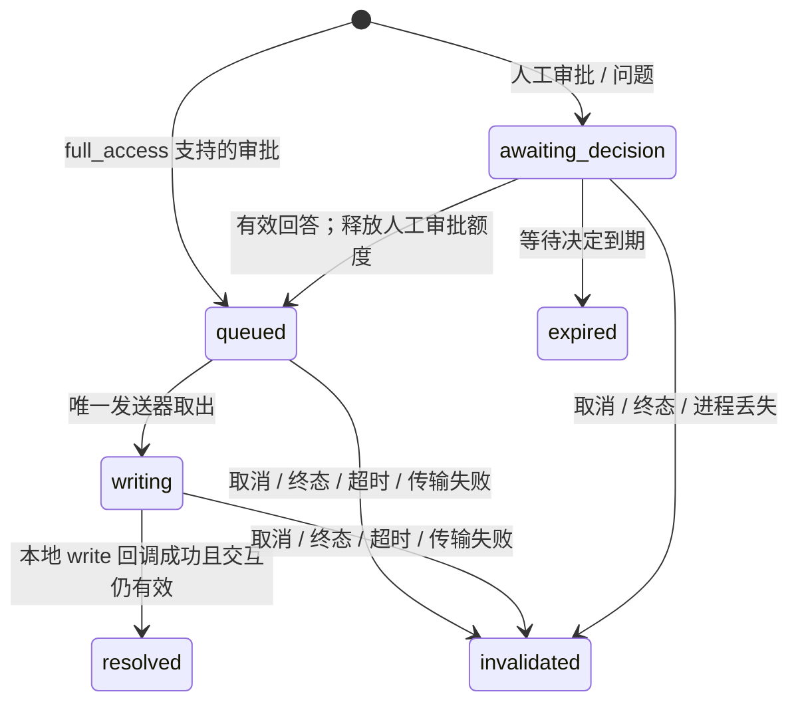

# 计划结论

采用“人工决定额度 + 单一 stdin 有界发送器 + 结构化错误传递”的实现。256 是用户明确要求；以下发送预算为本计划选定的工程初值，实施时用专项证据校准。不得把这些数值当作已经压测的生产结论。

## 1. 修改位置和边界

路径均相对仓库根目录，行号绑定本计划基线；实现前按符号重新定位。

| 位置 | 当前事实与拟改动 |
| --- | --- |
| `packages/octo-runtime-adapter-codex/src/app-server.ts:81` | `PendingInteraction` 保留 responding 区分等待决定与投递；增加类别和保留字节。queued/writing 由唯一发送器持有，不在交互表重复保存状态。 |
| 同文件 `#handleServerRequest:1835` | 拆分人工审批计数和自动投递；先校验身份/重复 ID/方法，再决定准入；满 256 的处理不调用整轮 queue.fail。 |
| 同文件 `respondNative:1432` / `respondInteraction:1522` | 两条响应入口共用“校验→决定冻结→投递”状态转换和一次性结算。 |
| 同文件 `#write:1993` / request / notify | 全部 stdin 写入改走同一内部发送器；保留 request 在写入前登记、onWritten 的原语义。 |
| 同文件 abort / close / handleProcessError / handleExit | 先停止普通发送并失效交互，清理投递 Promise，再沿现有进程清理；避免迟到回调发布 resolved。 |
| 新增 `packages/octo-runtime-adapter-codex/src/stdin-writer.ts` | 包内部发送器，管理 FIFO、单一在途 write、drain、字节预算、期限与停止，不导出为宿主 SDK。 |
| `packages/octo-runtime-protocol/src/failure.ts:617` | 将本任务明确的本地原因加入优先映射，沿用公共目录，错误诊断不得被 stderr 关键词覆盖。 |
| `packages/octo-runtime-protocol/src/run-protocol.ts:180` | 在既有容量分支之外，受限允许 Codex 的 HOST_EXECUTION_FAILED 携带本任务 failure；保留字段白名单与来源/原因校验。 |
| `packages/octo-runtime-executor-core/src/index.ts:940` | native catch 给本任务原因附带中央 failure；canonical 继续走 adapterFailurePayload。仅修改错误投影，不新增执行层。 |
| `.octospec/rules/output-protocol.md`、Codex 包 README 双语 | 实施后更新已实现合同、256 的含义、投递预算及失败解释。当前实现结果见验证记录。 |
| 新增 `test/manual/codex-approval-delivery.test.js` 及同目录 fixture/live 脚本 | 所有新增专项仅显式运行；复用现有输入和 Kernel fixture，不加入默认 test glob。 |

已排除的同名限制：`adapter-sdk/src/approval.ts` 与 `native.ts` 各有 16，但 `createCodexAdapter → runCodexAppServerTurn → CodexAppServerClient` 不调用这些交互桥；Core 的 pendingInteractions Set 没有 16 条检查。Gateway 的 64 条属于渠道自有合同，不把本次 Codex 256 解释为所有宿主均可展示 256 条人工卡片。

现有拓扑保持：宿主原生构造 Kernel → 内部 worker / AgentExecutor → Codex Adapter → 所属 app-server 子进程。发送器由每个 CodexAppServerClient 独占，包含的队列、监听器、计时器均由它关闭；不引入新服务或数据库。

## 2. 交互状态与额度

规则：

- 请求先经过原 invocation/thread/turn、类型、ID 和方法支持检查。native 原有 4096 个已见 requestId 的全轮保护继续有效；它与同时等待人工的 256 是不同预算，本次不移除或宣传无限全轮请求。
- 人工额度只统计 awaiting_decision 的 approval；ask/assisted 保持 Provider 映射，不能把 mode 名称当作实际审批已发生。有效决定与 queued 的转换在无 await 的临界段一次完成；队列准入失败则按投递失败收敛，不能恢复成可重复批准。
- full_access 的自动回复先冻结决定并标记 responding，再发布 `responseRequired=false` 的 pending，然后投递；防止消费者抢先回复。仍保留 requested/pending→resolved 审计顺序。
- 同步/异步问题和 elicitation 共用独立的 16 条未完成预算，保留原 10 分钟期限及超额失败语义；不占人工 approval 的 256，也不自动答复。为该旧类限制使用 `CODEX_INTERACTION_PENDING_LIMIT_EXCEEDED`，避免再次误称人工审批满。
- 人工第 257 条通过 JSON-RPC error `-32000`、固定 message `APPROVAL_PENDING_LIMIT_EXCEEDED` 明确拒绝。保持其他 256 条有效，不建立可由用户回答的 pending。native 保留实际收到的原生 request，不能制造 provider response；canonical 不制造 accepted/resolved，安全诊断记录容量拒绝。Provider 若随后自行失败，保留其真实终态。
- `item/permissions/requestApproval`、unknown method、扩权 grant 不因队列重构变为支持；沿用拒绝路径并结构化已存在的错误原因。
- `params` 只在验证回答仍需使用时保留。自动审批在生成回复/发布事件后不再由交互表长期持有完整 params；已冻结人工回答同样释放原始 params。输出事件仍独立受 DriverQueue 预算约束。
- 交互存活与发送器条目分别计数：人工已决定仍有交互身份但不占人工额度；本地写入完成立即释放投递记录，不等待工具终态。

## 3. 有界预算与单一发送器

| 预算 | 初值 / 作用域 | 达限行为 |
| --- | --- | --- |
| 等待人工 approval | 256 / invocation | 拒绝新增请求，不直接 fail 全轮。 |
| question + elicitation 未完成数 | 16 / invocation | 保留该类原有终止语义，使用独立原因。 |
| 等待回答的 params 总字节 | 本 invocation `adapterQueueMaxBytes`，默认 32 MiB | `CODEX_INTERACTION_BYTES_EXCEEDED`，本轮失败并有界清理。请求仍受原 rawMessageMaxBytes 单项限制。 |
| 普通发送条目，含唯一写入中条目 | 4096 / client | `CODEX_STDIN_QUEUE_ITEMS_EXCEEDED`，失败并清理本轮。 |
| 普通发送总 UTF-8 字节，含换行和写入中条目 | 64 MiB / client | `CODEX_STDIN_QUEUE_BYTES_EXCEEDED`，失败并清理本轮。 |
| 控制保留额 | 8 条且合计 64 KiB / client，独立于普通额 | 容纳协议拒绝及 turn/interrupt；人工额度拒绝属于正常突发，走普通队列，不能挤占此预留。不能给批准借用。耗尽时真实传输容量失败。 |
| 等待人工决定 | 600000 ms，沿用现值 | expired，按现有合同拒绝并结束本轮；不继续发送批准。 |
| 单条发送总期限 | 入队起 30000 ms，包含排队、write 回调和需要的 drain | `CODEX_STDIN_DELIVERY_TIMEOUT`，不因后续流量不断续期。 |
| 无发送进展 | 有发送债务时 5000 ms | `CODEX_STDIN_STALLED`；成功写回调或必要 drain 才算进展，stdout/stderr 活跃不算。 |

64 MiB 是内部传输预算：现有公共 invoke 允许 32 MiB，不能把整个 stdin 改成只够小审批响应的 1 MiB 队列而破坏正常文本/图片输入。需对最终序列化行计量，包含 JSON 包装。单条超过 64 MiB 同样拒绝；这不增加公共输入 32 MiB 的合法范围。4096 项覆盖要求的 32/100/256 小响应突发，仍防止大量小条目耗尽元数据。

上述字节预算是保留内容的序列化计量，不是 RSS 保证。JS 对象、字符串和一次序列化有额外开销。保留 params 的字节预算与输出队列分别核算；不能只限制回复小对象而遗漏 256 个大请求的保留内存。合法但极大的请求可能先达到字节上限，不能承诺任意大小的 256 条均可接纳。专项边界断言使用低于其他独立预算的小请求。

发送算法：

1. 预序列化一次，校验字节/条数，保存稳定 line、owner、deadline、onWritten/onError。不得在 request/notify 等其他路径直接调用 stdin.write。
2. FIFO 取一条为 writing；只允许一个本地 write 等待回调。安装 error/close/drain 监听并设置泵的重入保护，再调用 write。同步 throw、同步回调的 fixture 与异步回调均要正确结算。
3. write 返回 true 时，在其成功回调后发下一条；false 时，下一条必须等本条成功回调及 drain 均已观察到。两个事件顺序任意，不能错过提前发生的 drain。drain 不表示该条已写入成功。
4. write 回调成功即可确认该交互本地 written/resolved；如尚待 drain，发送器继续阻塞后续写，但不得将已 written 交互改报未送达。暂停发送只依赖管道状态，不等待工具执行或 RPC response。
5. 由一个 timer 调度发送器无进展期限与最早绝对 deadline 的较早者，有限条目的 deadline 检查不启动无界 Promise。重复 stop/失败共享首次 cause，所有条目一次性结算；迟到回调只清理引用，不再发下一条。
6. 控制队列在当前不可撤回 write 后优先发送；普通项之间 FIFO。控制预留不能绕过 false/drain。取消清除 queued 的普通项后可 best-effort 发一次 turn/interrupt；管道仍堵塞时现有进程清理期限优先，不能为等 5 秒 drain 推迟清理。
7. 普通 RPC 的原 timeout 从 request 登记开始，取其剩余期限与发送预算的更早者；若到期时还 queued，必须移除该发送条目，不能超时后迟发 turn/start。已 writing 的字节不可撤回，不自动重试。无需响应的 notify 写失败也必须进入共同失败路径，不得因无 onError 被吞掉。

以上初值集中为内部常量；单元验证可向内部 writer 注入受控时钟/小预算，不增加宿主配置字段。callback 成功而 drain 尚未发生时，交互记录可以释放，但发送器保留一个有截止的 drain 等待状态；后续没有 queued 项也不能漏掉对此等待的关闭和计时器清理。

实施核对既有消费者后，所有 pending expiresAt 保留原 10 分钟合同；自动投递另受发送器 30 秒截止约束，不为内部发送重构改变既有外部过期字段。人工决定接受后停止人工超时逻辑，投递截止取原 expiresAt 与入队 +30 秒之较早者；在等待投递时到期按 delivery timeout 处理，不能再发第二份超时拒绝。

## 4. 取消、失败和终态竞态

所有结果在本 invocation 的同一状态机结算：

| 触发 | 必须发生 | 不得发生 |
| --- | --- | --- |
| cancel / 观察到 Provider 终态 | 停止批准入队；删除 queued 的批准；尚未 resolved 交互 invalidated；结算回答 Promise；沿已有 cancel/close 清理 | 已失效批准在 drain 后迟发；重复终态。 |
| stdin write/stream 错误 | 保存首个结构化原因，停止发送器，拒绝全部等待，失效交互、RPC；继续既有进程回收 | canonical 回答失败后恢复 responding=false 让用户重复授权。 |
| exit / close | 不依赖 drain 或 write 回调一定到达；主动 settle 和移除本发送器监听/timer，保留原清理失败 | 仅 Promise.race 超时而后台继续发送；关闭共享 Kernel。 |
| timer 与回调同 tick | 已结算标志 + 交互仍存在且状态匹配；只发布一次 resolved/invalidated/expired | 把已 invalidated 改回 resolved，或返还两次额度。 |
| 已收到正常终态，但本地仍有未写完回复 | 取消未完成回复并保留实际终态；迟到回调不能再发事件 | 为发送完队列延迟/改写已确认终态。 |

写入中条目在 Node 缓冲中可能已经部分送达，无法撤销。取消不是“Provider 一定没有执行”的保证；通过 turn/interrupt 和所属进程清理收敛，绝不重放审批或重发本次任务。进程清理失败仍报告 incomplete，不因清空 JS 队列冒充进程已退出。

现有输出 DriverQueue 容量也会独立失败。接入其 onFailure，使输出预算失败立即停止本轮审批接纳/发送并启动同一清理，不等待消费者下次 next 才停止生产；保存最先失败原因，防止 invalidated 事件再次 push 到已关闭队列引起递归失败。既有输出预算不提高，不能为了通过审批 burst 去扩大源窗口。

## 5. 错误归因与 native 合同

所有本地错误用 `Error.code` 保存稳定原因，原 errno/cause 作为诊断。明确映射优先于 message/stderr 关键词：

| 原因 | 公共目录与策略 |
| --- | --- |
| APPROVAL_PENDING_LIMIT_EXCEEDED | 原因对应人工容量拒绝；正常只作为该请求的 JSON-RPC 拒绝和安全日志，不制造整轮失败；若显式进入分类器，映射 OH-ADP-3004。 |
| CODEX_INTERACTION_PENDING_LIMIT_EXCEEDED / CODEX_INTERACTION_BYTES_EXCEEDED | OH-ADP-3004；明确指出交互类别/保留预算。 |
| CODEX_STDIN_QUEUE_ITEMS_EXCEEDED / CODEX_STDIN_QUEUE_BYTES_EXCEEDED | OH-ADP-3004；保留明确 reasonCode，不误用“尚未启动任务”的 OH-RUN-2003。 |
| CODEX_STDIN_WRITE_FAILED / CODEX_TRANSPORT_FAILED | OH-ADP-3004；仅已确定的本地传输错误使用，Provider RPC 原生拒绝不得笼统包装成此原因。 |
| CODEX_STDIN_STALLED / CODEX_STDIN_DELIVERY_TIMEOUT | OH-ADP-3013；对这两项覆盖 retryable=false、action=contact_admin，因为命令可能已经开始，不能建议无条件重跑。 |
| INTERACTION_EXPIRED / APPROVAL_GRANT_SCOPE_UNSUPPORTED / APPROVAL_OPERATION_UNSUPPORTED | OH-ADP-3004；补齐现有本地分支的结构化 code 和优先映射。 |

分类器只凭明确 code 优先映射，不从 stderr 中搜索这些大写名字强行覆盖真实认证错误；不全局屏蔽 Unauthorized。canonical 可以保留既有脱敏诊断文本，准确分类依赖结构化原因。真实 RPC/turn 错误继续进入现有 Provider 分类。

native 采用已有 `HostControl.error {code: HOST_EXECUTION_FAILED, message, failure}`，不新增公共 error 枚举：

- Core 只对本表的 Codex 本地原因附加中央生成 failure；保留 source.adapter=codex，reasonCode、公共 code、category/messageKey/action 等与中央映射一致。
- 中央分类器为本表原因输出空 params；两项投递超时不沿用 RPC timeout 的配置提示，因为此处采用内部发送期限，不应让用户修改无关的 requestTimeoutMs。retry/action 覆盖同时适用于 canonical 与 native。
- run-protocol 校验器增加此窄分支，验证外层 code、source、原因映射及既有完整字段白名单；params 固定空对象，容量测量留在安全日志。现有流容量分支和其 params 白名单保持严格。
- Schema 当前已经允许 error 的可选 FailureEnvelope，因此不新增 wire 字段或协议版本，不改生成文件。若实现发现必须改 Schema，先补齐计划并运行生成一致性检查，不能直接手改类型。
- canonicalEvents、Kernel 源窗口和 TS/Go/Python 原生客户端应保留原 failure，不由消费者再匹配文本；专项验证新增允许分支、篡改原因/来源/params 的拒绝和旧无 failure 帧继续兼容。
- SDK native pending control 仍没有 reasonCode 字段，不借本任务给 interaction control 新增字段。第 257 条的拒绝通过 Provider JSON-RPC 和低基数元数据日志可观察。

日志只记录 code、调用关联、等待人工数、queued/writing 数、序列化 bytes、limit 和耗时。禁止命令、问题正文、完整 params、凭据或原 stderr 进入新增日志。日志可丢弃的既有合同不变，审计主事实仍沿正常事件流。

## 6. 实施顺序与退出条件

1. **固定基线与复现**：实施前 fetch、核对相关源码是否漂移；在 `test/manual/` 建确定性 fixture，验证旧代码的自动 burst 和 stderr 误分类。保存红测，不能只测试新常量。
2. **内部发送器**：单独实现 FIFO、write/drain 双条件、保留额、deadline、stop 和一次结算。覆盖同步 throw、回调/drain 交换顺序、close 没有回调及取消迟到写，全部通过再接入 app-server 全部 stdin 出口。
3. **交互状态分离**：人工 256、非审批 16、自动 bypass、冻结回答、params 字节预算、257 负响应。运行 native/canonical 两模式矩阵，检查全轮无重复回复和虚假 resolved。
4. **错误链路**：补 code，中央映射，Core native failure 接线和严格校验；用 Kernel 公共入口验证传播。保留真实认证、已有容量/超时和其他 Provider 回归。
5. **集成与资源收敛**：运行整链路 fake Provider、压力/竞态及相关既有回归；确认 cancel 不迟发批准、请求 timeout 不迟发 turn/start、兄弟 invocation 不受影响。
6. **独立真实验收**：保持同一受保护 CODEX_HOME、Provider 配置/认证和 MCP 映射；只读并发工具，不修改业务批量或提示词规避。分别记录两模式、shell 与动态 MCP；失败或未形成突发不能写通过。
7. **交付准备**：更新合同与验证记录，执行已有 lint/typecheck/test、知识检查和 CI 范围核对。公开 issue/PR/commit 使用英文，Linked Spec 与 COMPREHENSION 说明旧/新行为、影响与实际证据。提交/推送/PR 已获用户本轮授权；Work App 待上游合并后独立接入。

现有 shell 的 PATH 未含 node，但已验证 Codex bundled Node `v24.19.0` 可执行，pnpm 为 `11.25.0`。实施者先将已安装 Node 的 bin 加入本次 shell PATH，检查 `node --version`，再执行 `pnpm install --frozen-lockfile`；不修改账号全局配置。此次探测 `pnpm exec node --version` 触发了自动依赖安装，prepare 因 PATH 缺 node 失败，未改 tracked 文件。实施阶段必须重新完成安装/构建，不能将当前 node_modules 存在当作就绪。

## 准备度与剩余缺口

| 维度 | 得分 | 依据 |
| --- | --- | --- |
| 需求与授权范围 | 20/20 | #289、人工 256、实施及 PR 授权与 CI 边界明确。 |
| 源码定位与调用链 | 20/20 | 最新主线、真实入口、共享 stdin、两模式与校验器均核对。 |
| 状态/资源/失败合同 | 20/20 | 额度释放、双条件发送、取消不可撤销、错误映射及兼容边界已确定。 |
| 实施拆分与命令 | 18/20 | 阶段/文件明确；新增 fixture/live runner 尚待实现，依赖需在正确 PATH 完成构建。 |
| 验收覆盖与现实风险 | 18/20 | 确定性矩阵完整；真实 Provider 拒收行为和预算/跨平台时序尚无本次实测。 |
| 合计 | **96/100** | 计划准备度，不是统计概率。 |

无待用户决定的关键产品分叉。剩余证据在实施步骤 1、5、6 获得：Provider 对 -32000 容量拒绝可能自行结束整轮；真实模型不保证按提示产生 256 个并发工具；64 MiB/4096/5 秒/30 秒须测实际保留量及延迟；macOS 的结果不替代 Windows。若专项发现预算不足，在上述所有权和有界原则内调整并记录实测依据，不能靠改业务并发或无限增大额度通过。
