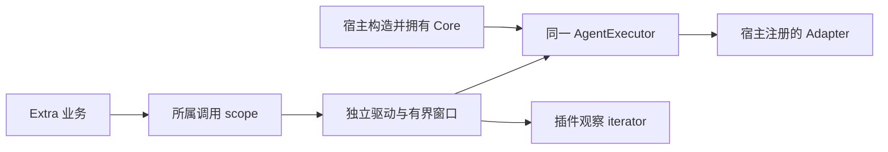

# 设计

本文保留基于 `bd287f95` 的设计依据，现已在 `6fe5b5fc` 基线上实施。实际 API 为 ExtraExecution/ExtraExecutionContext、Core.status、waitForInvocationCleanup；source.settled 区分后台消费与终态，describe 的可选 onProbe 观察真实在途。验收见[验证记录](validation.md)，不表示已发布 npm。#313 按用户要求暂缓。

## 已核对的实现差距

| 源码 | 当前事实 | 所需改动 |
| --- | --- | --- |
| `packages/octo-runtime-host-sdk/src/extra-service.ts:33` | 必填 home/endpoint，initialize attachKernel，状态为 kernel_available | 加互斥选择、direct 无 Home 分支和 transport-independent 状态 |
| `packages/octo-runtime-host-sdk/src/extras.ts:15` | ExtraContext 必填 kernel；ExtraPlugins 构造器接收 KernelClient | 注入 scoped execution，保留受限 IPC 兼容入口 |
| `packages/octo-runtime-extra-channel-{gateway,wecom}/src/ports.ts` | 使用 KernelClient 的 invoke/cancelInvocation/respondInteraction 子集 | 改用公共执行接口及业务所需子集 |
| `packages/octo-runtime-extra-webui/src/index.ts:182` | list 返回探测状态；其他路径 invoke/cancel/respond | direct list 必须映射 describe，不能误用 Core.list 元数据 |
| `packages/octo-runtime-executor-core/src/index.ts:379` | owner 清理 Promise 与失败保留在私有结构，只有 shutdown 汇总可读 | 增加单次调用只读清理凭据和 Core 接纳状态读取 |
| `packages/octo-runtime-executor-kernel/src/host-run-service.ts` | 已有独立驱动的 submit、真实帧有界窗口及观察游标 | 优先复用其独立驱动/窗口机制，外侧增加 scope 所有权，不构造 KernelService |
| `packages/octo-runtime-executor-kernel/src/invocation-lifecycle.ts` | 每 client 独立登记、128 条上限、ACK/未知/显式取消处理 | IPC 保留同一实现，direct 不模拟 RPC 恢复或 KernelRunRef |
| `packages/octo-runtime-host-sdk/src/shutdown.ts` | Extra 单调关闭预算 4000 ms，继承更早期限 | 两种模式均沿用，不套用 Kernel 的 5 秒期限 |
| `package.json` / `public/host.ts` / `public/extra.ts` | 无 Codex 公共子路径；新执行类型也未导出 | 最小导出补齐与 #296 协调，包外编译/加载验收 |

## 配置与 Home

以下为目标类型骨架，CommonOptions 保留 module/config/dependencies/enabled/controlEndpoint/logging：

```ts
type ExtraExecution =
  | { kind: "direct"; executor: AgentExecutor; endpoint?: never }
  | { kind: "ipc"; endpoint: string; executor?: never };

type ExtraServiceOptions<D extends object> = CommonOptions<D> & (
  | { execution: Extract<ExtraExecution, { kind: "direct" }>;
      endpoint?: never; home?: string }
  | { execution: Extract<ExtraExecution, { kind: "ipc" }>;
      endpoint?: never; home: string }
  | { execution?: never; endpoint: string; home: string }
);
```

运行时在资源分配前按**字段是否存在**检查互斥，不依赖 truthy 或 `undefined` 的绕过行为。拒绝 null、数组、未知 kind、缺值、两分支字段共存、`execution + 顶层 endpoint`。executor 必须是宿主传入的真实 AgentExecutor，验证方式须适配发行物与声明实际导出的同一类；不得仅凭一个具有 invoke 方法的对象或类型断言接受伪对象。直接保留对象引用，不 clone、冻结或重建 executor。端点沿现有 `assertIpcEndpoint` 校验；不把地址可用性当作语法校验。

严格类型专项启用 `exactOptionalPropertyTypes=true`，覆盖 `endpoint?: never` 等互斥字段。当前仓库 strict 配置并未开启此项；不为本需求全局改编译开关。消费者关闭该选项时，TypeScript 允许部分 optional 字段显式为 undefined，运行期仍按字段存在性拒绝；文档须说明此编译器边界，不能声称任意 TS 配置都与运行期完全等价。

direct 的 home 可省略；省略时完全不解析默认 Home、不创建根、身份或内核记录。不配置控制端点和文件日志即可无 Runtime Home 初始化。若宿主显式提供 home，则仍校验原始绝对路径和根可用性。IPC/legacy 保留 #306 的必填已准备 home；issue IPC 示例比本基线少 home，实现文档必须补齐，不能直接照抄。

direct 的可选 controlEndpoint 由宿主显式选择。无 home 时 POSIX 父目录须由宿主先准备，独立校验路径、权限及预算，复用 acquireEndpoint 的独占和失败留存；不在任意目录隐式 mkdir。Windows 用原 named pipe 规则。控制租约不是执行租约。显式 logging.directory 独立校验并保留 best-effort 约定，不让可选日志隐式生成 Runtime Home。日志与控制资源必须保留 #306 的路径诊断和迟到 bind 清理。

## 最小 Extra 执行接口

目标接口沿现有类型复用方法签名，不复制 InvokeInput、HostFrame、CanonicalEvent 或交互 Schema：

```ts
interface ExtraExecutionContext {
  readonly kind: "direct" | "ipc";
  readonly invoke: InputInvoke;
  cancelInvocation(id: string, reason?: string): Promise<{ accepted: boolean }>;
  respondInteraction(id: string, response: InteractionResponse): Promise<void>;
  respondNativeInteraction(id: string, response: NativeInteractionResponse): Promise<void>;
  list(): Promise<HostedAdapterMetadata[]>;
}
```

服务私有 scope 另持有 stopAdmission/drain/release；插件拿不到 executor、shutdown 或可全局排空的资源。native/default、canonical 及变量模式三个重载保持严格输出类型。通用层使用现有 `createInputInvoke`、身份生成与校验；输入准备仍由 Core 执行一次。

| 通用动作 | direct 委托 | IPC 委托 |
| --- | --- | --- |
| invoke | 同一 executor.invokeFrames，通过有界执行源独立消费后提供观察视图 | 当前 client.invoke，保留其提交/恢复/登记实现 |
| cancelInvocation | 只对 scope 已接纳的同一 receipt 调用 Core.cancel，返回 ACK | 当前 client.cancelInvocation |
| respondInteraction | 同 scope、原模式与活动交互校验后 Core.respondInteraction | 当前 client.respondInteraction |
| respondNativeInteraction | 同 scope 校验后 Core.respondNative，保留原生 payload | 当前 client.respondNativeInteraction |
| list | Core.describe，返回实际 probe 元数据 | 当前 client.list |

direct 的 describe 会启动实际 probe。scope 必须登记自己启动的查询 Promise；停止准入后拒绝新查询，到期仍在途返回 incomplete。底层 probe 仍归共享 Core 监督，不能因展示超时释放真实在途，也不能为 Extra A 取消 B 的探测。list 是已注册 Adapter 的探测，不是模型目录或认证保证。

## scope、身份及控制

direct 用 `WeakMap<AgentExecutor, ...>` 保存对象级协调器，再按 Extra name 管理实例所有权。这只协调显式共享同一对象的消费者，不是全局 executor 单例。IPC 保留当前 endpoint 规范化/name 键与每 Extra 的独立 client。现有最多 64 个 Extra 的容量约束保留，不因 WeakMap 失去计数。

每个 scope 最多登记 128 个 admitting/accepted/unresolved 调用。首次消费时固定身份并登记；没有开始消费的 iterator 不提交。只在源首帧给出匹配 receipt 后才允许按 id 向 Core 路由控制。接纳前取消只取消本调用的独立 signal，并等待接纳/拒绝结果；不能拿用户提供的 invocationId 直接取消共享执行器中的其他调用。明确拒绝不登记为成功接纳；同 id/runId 冲突不能夺取原调用。

接纳后控制须匹配 scope 记录、完整 receipt 和活动状态。跨 scope、已退役、未知或同名不同 Core 的 id 在转发前拒绝。A close、A 初始化回滚和 A 的 signal 都只触发 A 的记录。宿主直接使用 executor 的调用不进入 Extra scope。

direct source 协调器按 executor 对象共享总缓冲预算；每个 Extra 只有自己的句柄集合。释放 A 的 scope 不调用共享 source 的全局 close/beginDrain。只有协调器不再被使用且没有实际任务/清理遗留时才能销毁其 timer/window。未确认清理仍占身份和容量，不能靠重建协调器或重新加载绕过；显式宿主 shutdown 后也须保留已返回失败的事实。

## 执行与观察分离



优先复用 HostRunService 的 submit/窗口/帧序列校验；必要的小范围重构只抽出无 Kernel 监听、Home 或全局 shutdown 副作用的内存机制。**不能直接把它的 invokeFrames 返回给插件**，该路径仍由消费者驱动。不能用 `as KernelClient`、伪 endpoint 或伪 RunRef 让 direct 通过检查。Core 只有一份执行实现；这里的独立驱动是所有权适配，不是第二个 Provider 调度器。

- 首次 next 触发一次接纳；接纳后 pump 持续消费，observer.return 只卸载观察者，不调用 Core iterator.return。
- 复用中央 StreamLimitPolicy：默认每 Run 4096 帧/32 MiB、总序列化窗口 128 MiB、最多 128 Run，终态 TTL 120 秒及既有硬最大值。预算按 executor 协调器共享，不为每 Extra 各新增一个无总额约束的大窗口；Core 自有调用不因此被纳入该窗口。
- 窗口采用现有淘汰/游标缺口语义，不因观察者暂停而无限积压。慢观察落后于窗口时明确报 gap/观察失败，保留调用记录；这不隐式取消已接纳工作。已脱离的观察者不积累专属输出队列。
- 超大源帧或协议错误沿现有执行错误路径处理，明确记录执行与清理结果；不静默丢失后报告成功，不伪造 Provider 成功事件。
- explicit cancel、调用方 signal、Extra close、既有任务过期仍请求取消；取消 ACK 不结束 pump。Channel WS 断开只改变连接生命周期，不撤销任务 signal 或重新提交。
- 不对外提供 direct 的 durable replay、Kernel ACK 查回或跨进程恢复。进程失败后由宿主处理业务，不能自动重跑。

## 单次调用清理凭据

当前 Core 将 `cleanupAttempt/cleanupState` 私有保留，流 finally 可能不等待清理结束。自然耗尽、终态甚至 `iterator.return()` resolve 均不足以证明 owner 已回收，因此该项是 direct 支持的实施前置步骤。

拟向同一个 Core 实现增加只读 `waitForInvocationCleanup(receipt, { deadline })`，返回 `complete / pending / failed / unknown` 及匹配的身份；确切 TS 名称在 M1 锁定。receipt 至少校验 run_id、invocation_id、stream_id 和协议/会话身份。方法只观察**该次已接纳调用**的首次 cleanupAttempt，不触发全局关闭、不重复 return、不取消其他调用、不将查不到记录解释为 complete。结果由原 owner 的成功/失败产生，在现有有界身份记录中保留，不能等 owner 删除后再猜测成功。

未接纳由调用路径的明确拒绝凭据处理；不能传别的 Run 的 receipt 取得证明。超时返回 pending/unknown；首次 finally 失败保留 failed，即使之后 return 变成空操作。迟到成功可作为后续状态事实记录，但不能倒改已经返回的 close 结果，也不能自动释放 failed Extra 的冲突所有权。M1 必测：终态后延迟清理、finally 抛错、卡住 next、错误 receipt、拒绝接纳与 id 冲突。

另外增加只读接纳状态读取（拟 `executor.status()`，只返回 Core 生命周期/是否开放）。direct 服务用它区别宿主已关闭与可接纳，不通过 probe 或执行测试 turn 判断 readiness。它不声称 Provider 认证完成。

## 关闭与失败

首次 close 或初始化回滚即固定现有 4 秒单调截止；转换给 IPC 的 Date.now 绝对 deadline 仅在起点计算一次。Kernel 自己的 5 秒、Core 默认 shutdown 的 2.5 秒均不替代 Extra 预算。

1. 同步关闭 scope invoke/list 准入，通知插件停止新业务；取消本 scope 的在途调用，缓存同一 drain Promise。
2. 并行等待所属执行排空和插件 dispose。插件继续消费尾流，可在原截止内调用宿主依赖完成已接纳业务收尾。
3. direct 逐个核对 pump 与 Core 单次清理凭据，等待所属实际 probe；IPC 复用 client.invocations.drain 的原终态/未知合同，不重写恢复逻辑。
4. 插件结束或到期时撤销后续依赖调用权限，等待真实已开始的 Promise；失败仍尝试其他独立资源。
5. 释放本 scope、IPC 本 client、控制监听和日志。完整才释放名称/租约；失败返回 incomplete 并保留冲突所有权与可诊断资源。

IPC 的 drain 依据现有远端执行状态，不能证明 Kernel 全局资源已关闭；Extra.close 只负责自己的调用及本地资源，不承诺 Kernel 后代全部退出。收到具体清理失败仍须保留失败。direct 在同进程必须取得自己的 Adapter 清理凭据，不能把 IPC 的终态判定直接当作 direct 清理判定。若后续要把远端逐调用资源清理证明加入 wire，另行按协议需求设计，不在这里伪造能力。

初始化失败保留 ServiceInitializationError.cause 和 cleanup。close-before-initialize 永久拒绝启动；并发/重复 initialize、close 沿既有缓存行为；控制 bind 迟到仍回收且不改写已返回 incomplete。服务不关闭宿主数据库，不安装信号处理器，不调用 process.exit。

宿主停机顺序为：停止业务准入 → 关闭所有 Extra 并检查 complete → 停止其他 Core 使用方 → 宿主调用 executor.shutdown 并检查 cleanup → 宿主关闭数据库/进程。IPC 的 Extra host 不关闭 Kernel；Kernel owner 独立安排全部消费者及服务关闭。

## 状态与迁移

建议 ExtraServiceStatus 增加 `execution: { kind, available }`。available 表示当前 Core 接纳开放或 IPC execution_ready，不等于 Provider 安装、认证和业务通道健康。保留 Extra 自身 phase/name/pid/plugin。`kernel_available` 仅 IPC 返回，direct 不赋造假的 true/endpoint/Kernel PID；日志新增种类元数据须通过现有白名单，不记录凭据或正文。

内置三个 Extra 全部改用 `context.execution`。兼容 `context.kernel` 只在 IPC 存在，真实值仍为原 client；类型需显式表达可缺省并提供 IPC context 类型/收窄方式。已有只读 kernel 的 JavaScript 插件可继续以 legacy endpoint + home 运行；严格 TypeScript 源码若原来假定 kernel 永远存在，需要改为 IPC context/存在性检查，文档必须公开这一类型迁移成本。不得声明“所有旧插件零改动支持 direct”。

ExtraPlugins 的现有公开 KernelClient 构造用法保留 IPC overload；新增内部 execution 装配保持两阶段插件入口，不将 transport 选择塞进业务 JSON。旧插件需要 submit/get/subscribe 时继续 IPC，不为 direct 模拟这些方法。仅经迁移且验证的插件才能列为 direct 支持；错误使用 direct 的 Kernel 专属插件应明确失败并完整回滚。

## 与当前规则的衔接

| 当前规则 | 实现阶段须修改的适用范围 |
| --- | --- |
| architecture 的 #294、选型、统一服务及图示 | Kernel-hosted/IPC 继续统一 RPC；#312 direct 是显式独立装配，不作为 KernelService 内部绕行 |
| extras 的 ctx.kernel 和每 Extra 一个 client | 改为每 Extra 一个 execution scope；IPC scope 内仍一个真实 client |
| local-execution 的所有 Extra 走 IPC | 限定 IPC，新增 direct 观察/取消差异，保留 IPC 独占与恢复 |
| runtime-lifecycle 的所有 Extra 必填 home | IPC/legacy 保留；direct 无 Home 前提，可选显式资源独立校验 |
| engineering/channel 文档里的 Kernel 专属表述 | 按两种 execution 更新调用端，保持渠道业务策略与 async 交互过滤 |

本轮只在任务中记录计划，不把未实现能力写入当前 Rule；M1 实现前同步有范围的规则修订。用户指向 #312 的规划目标足以定义此提案，不需要再次请求已明确的模式选择。
