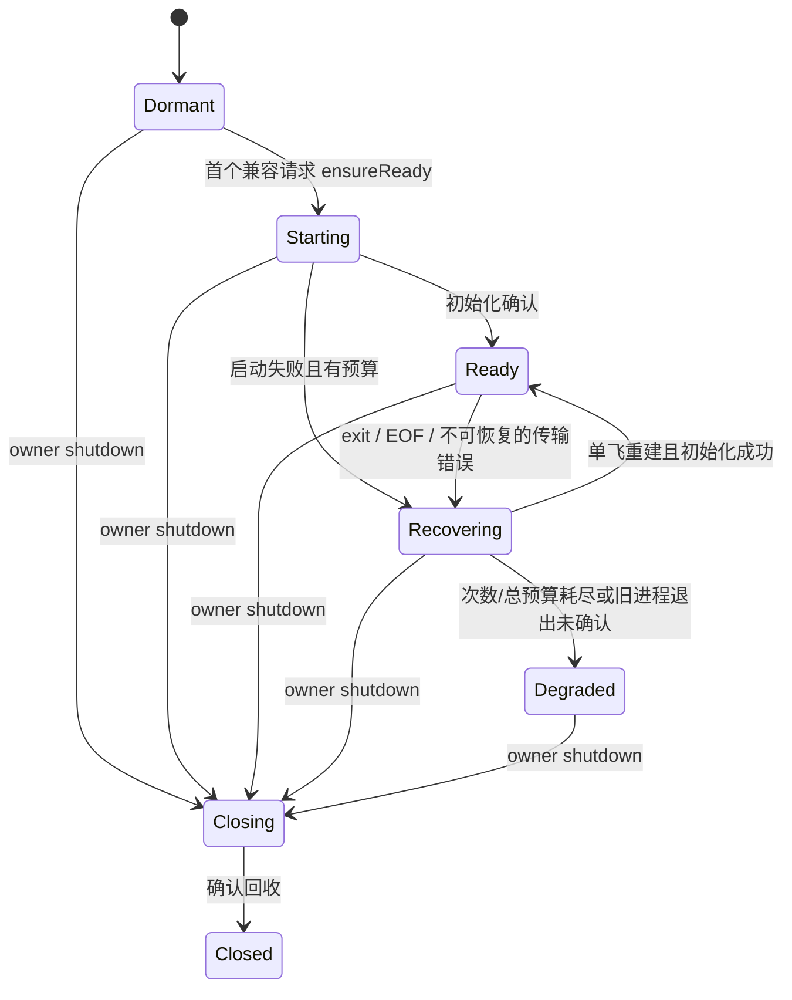

# 设计状态与事实依据

以下保留规划合同；现状表描述规划基线 `de3ff37a86ee3cb8f6ab66148ceca817f6ae5240`，不是实施后的源码状态。当前实现与未验边界以[验证记录](validation.md)和[分层验收](acceptance.md)为准。

| 现状 | 代码依据 |
| --- | --- |
| 每轮创建命令并启动 app-server，声明 subprocess-per-invocation | [Codex index.ts](../../../packages/octo-runtime-adapter-codex/src/index.ts) 的 createCodexAdapter / buildCodexCommand |
| runCodexAppServerTurn 新建客户端，finally 关闭；initialize 超时的局部重启不是 supervisor | [app-server.ts](../../../packages/octo-runtime-adapter-codex/src/app-server.ts) 的 runCodexAppServerTurn / closeClientAndResources |
| signal、queue、normalizer、pending、thread/turn 与进程同在一个对象 | 同文件 CodexAppServerClient；取消 timer 会触发进程清理 |
| HTTP MCP header 生成每轮随机 OCTO_MCP 环境名 | [mcp.ts](../../../packages/octo-runtime-adapter-codex/src/mcp.ts) 的 codexMcpConfig |
| Core 注册原 Adapter；shutdown 只等 invocation owner 和 probe | [Core index.ts](../../../packages/octo-runtime-executor-core/src/index.ts) 的 register / shutdown |
| Kernel close 已统一进入 Core.shutdown，外层预算 5 秒 | [server.ts](../../../packages/octo-runtime-executor-kernel/src/server.ts) 的 teardown |
| writer 的 cancelPending 会停止整个发送器准入 | [stdin-writer.ts](../../../packages/octo-runtime-adapter-codex/src/stdin-writer.ts)；持久化后必须增加逐 owner 撤销 |

规划时已只读核对本机 `codex-cli 0.164.0` 的 `app-server --help`，并离线生成该版本 JSON Schema。schema 中 thread/start/resume 支持 config，turn/interrupt 要求 threadId/turnId，thread/unsubscribe 存在。审批和 user input 带 threadId/turnId；MCP elicitation 的 turnId 可以为空，因此不能一律假定交互具有完整轮次身份。该阶段未启动真实服务或调用模型；实施后的真实验证另见验证记录。

[官方 App Server 文档](https://developers.openai.com/codex/app-server/)用于核对 stdio、每连接一次 initialize 和 thread 退订机制；这些协议描述不证明本机多线程并发、配置隔离或异常恢复已通过。版本变化必须重跑 M0，不能仅据在线文档准入。

## 1. 所有权与最小公共合同

选择 **Core 持有执行作用域，Adapter 实现 Provider 服务**。在 Adapter SDK 增加可选 createExecutionScope，在 HostedAdapter 镜像同一结构类型。Core、Kernel 不 import 具体 Codex 包。未实现该 hook 的 Adapter 保持现有逐轮行为。

拟定接口结构如下，最终类型名可按仓库惯例调整，语义不得省略：

```ts
interface AdapterExecutionScope {
  invoke(request: InvokeRequest, context?: AdapterInvocationContext): AsyncIterable<AdapterOutput>;
  respondInteraction?(invocationId: string, response: InteractionResponse): Promise<void>;
  respondNative?(invocationId: string, response: NativeInteractionResponse): Promise<void>;
  processes?(): readonly ServiceProcessSnapshot[];
  beginShutdown(reason: string): void;
  close(options: { deadline: number }): Promise<{
    complete: boolean;
    unresolvedServiceIds: readonly string[];
    failedCleanupServiceIds: readonly string[];
  }>;
}
```

createExecutionScope 接收现有受控 RuntimeLog。deadline 使用 `performance.now()` 的绝对毫秒值；Core 从原 shutdown timeout 换算一次，各阶段不重置预算。返回的运行方法只处理本 scope；beginShutdown 同步关闭准入并永久关闭恢复许可，close 使用同一次关闭 Promise。

register 同步创建无进程副作用的 scope，成功后原子登记；失败不能留下半注册。Core 调用和 respond 都路由已绑定 scope。相同 Adapter 对象可在多个 Core 注册，但 scope 不共享；同一 Core 仍按 type 拒绝重复注册。对象返回值须保留原方法 this，不用展开复制丢失宿主语义。

Codex 原始 adapter.invoke 和底层 runCodexAppServerTurn 不再隐式拥有一次性进程。内部入口改为接收显式服务/轮次句柄；直接消费旧低层入口需迁移为 Core，或显式创建并最终关闭 scope。未绑定调用明确拒绝 `CODEX_SERVICE_SCOPE_REQUIRED`，不悄悄恢复逐轮 spawn。主包 `/adapters/codex` 已由 #312 导出，接入仍是 createCodexAdapter → executor.register。导入默认 codexAdapter 不启动进程。

shutdown 顺序为：关闭 Core 准入 → 对全部 scope 调用 beginShutdown → 取消/排空所属轮次与 probe → 关闭服务 → 汇总。即使轮次清理失败也尝试独立服务清理。scope close 先取消恢复 timer 和 startup waiter，再处置迟到启动成功的 child；不得发布迟到 ready。

ExecutorShutdownResult 增量增加 unresolvedServiceIds / failedCleanupServiceIds。服务遗留不得伪造成 invocationId；即使没有活动轮次，服务清理失败仍使 cleanup=incomplete。Kernel 沿现有 cleanup 检查保留 manifest/endpoint 租约。此次不新增 Kernel wire 方法；按用户追加的 doctor 需求，既有 status 增加可选的常驻服务进程快照，详见下文。该增量须同步 Schema、生成类型、运行期校验及跨语言解码，不改 Run/Context/IPC 版本。

## 2. 服务状态与轮次状态拆分

| 服务持有 | 单轮持有 |
| --- | --- |
| command/args、启动 cwd/env、兼容键、child、stdio reader/writer、有界 stderr | request 快照、signal、deadline、原 invocation/receipt |
| serviceId、incarnation、initialize Promise、进程身份、退出观测 | threadId、turnId、native/canonical 模式、normalizer |
| RPC 关联 Map、writer、健康状态、恢复预算、关闭 Promise | queue、交互、async question、finalization、终态与清理结果 |

RPC pending 条目必须记录 owner 与 incarnation，生命周期请求归 service owner，thread/turn 请求归 invocation owner。服务不捕获首轮 request/signal。initialize/initialized 只属于本连接，不把共享握手广播或复制成每轮的 native 响应；执行相关 native payload 仍保留原始 ID/结构和未知可选字段。



ready 只表示本服务连接初始化完成，不表示已认证、模型请求成功或 Kernel 全部 Provider 健康。注册、Core available、Kernel execution_ready 保留原有含义。服务状态转换通过既有 RuntimeLog 的固定安全元数据可见，不借 discover/list 额外启动服务。

## 3. 兼容键与配置边界

首版采用保守隔离：**无法证明是 thread/turn 层配置的值均进入进程兼容键**。服务在第一次使用的 ensureReady 内启动，之后保持到 owner close，不按轮次、空闲 TTL 或 LRU 销毁健康服务。

| 值 | 首版处理 |
| --- | --- |
| 实际 executable 路径/文件身份、实际版本、启动 argv | 键内；版本与启动路径在服务准备时核对，不按 Provider 名称猜安装 |
| CODEX_HOME、完整有效进程环境（含 Context envs、executionEnvOverrides、MCP 私有值） | 键内；Windows 复用现有大小写合并语义；不修改 process.env |
| 启动 cwd、容量 -c 参数、原生进程选项 | 键内；保留现有 workdir 原生配置加载语义，不为了扩大复用省略 cwd |
| 解析后的本轮 MCP 配置、header/env 实际值、skills/插件等配置修订 | 键内；保留原生名称冲突、模板展开和白名单合同 |
| 有效 rawMessageMaxBytes | 键内；共享 reader 在 parse 前执行该预算，不能由另一轮放宽普通输出限制 |
| 模型、effort、权限、workdir 的原生 thread/turn 参数 | 继续逐轮传；workdir 也参与启动键，是首版保守选择 |
| prompt、业务 Context、图片、会话 ID、输出模式、signal、交互超时 | 不进入共享进程配置，保存在各轮；流限制按本轮执行 |

先对有效语义配置进行稳定排序/编码，再用 scope 私有随机 key 做 HMAC；不输出配置摘要或敏感值。使用精确语义相等检查处理键匹配，不把未经验证的 hash 当成隔离证明。环境的缺失值与空字符串不同，argv 顺序和数组顺序保留。

MCP HTTP header 转换在选定服务之后生成一次 service 私有环境名；相同语义配置复用该映射。不得先调用每轮 randomUUID 生成的 codexMcpConfig 再计算键，否则同配置仍无法复用。MCP header 变化或被展开环境变化必须选新服务，不能只比较模板文本。

不扫描或读取凭据/skills 文件来推断账号和修订。同一个 CODEX_HOME 本来就是同一原生状态边界，不能视为多用户隔离。宿主在原地更换账号、文件配置、skills/插件或 executable 时，必须改变受信 `providerOptions.codexServiceRevision`，或完整关闭旧 Core 后重建。该字段仅标识配置修订，不承担登录、刷新或租户授权。没有显式修订时不承诺自动发现磁盘变化；文档必须说明这一限制。

容量拟定为每 Core/Codex scope 最多 **8 个服务兼容配置**，包括 starting/recovering/degraded/清理未确认的记录。第 9 个不同键明确返回容量错误，既有服务继续可用；不退回 per-invocation、不清理健康服务腾位。阈值是首版工程默认而非实测性能结论，需要 M0/M5 记录资源代价。

## 4. 并发、路由与内存

目标为同服务最多 **8 个不同 thread 的活动轮次**，同 thread 单活动轮次，冲突明确拒绝 thread busy。首版不增加无限等待队列；starting/recovering 的调用最多 128 个、保留请求序列化预算总计 32 MiB，等待计入原调用 deadline，超限/取消立即拒绝且不发 turn/start。以上容量不表示进程 RSS 上限。

这不是从当前单 active 客户端推导出的能力。M0 必须对 0.164.0 实测多 thread、重复 resume、同 thread 冲突和交互交错；未通过则阻止 M2 的多路复用交付，并修订并发合同与评分，不静默改串行、复制服务或假报并发通过。

响应按 `(incarnation, rpcId)` 找 pending；通知按确认的 thread/turn 路由。thread/start 和 turn/start ACK 前的通知进入受限临时窗口，按原生 thread/turn ID 暂存，收到对应 RPC 结果后才绑定 invocation 并排空。无关联或不属于已接纳操作的事件不分给“当前唯一调用”。实施采用最多 128 帧/32 MiB 的临时窗口；超限明确失败，不能无界等待未知 ACK。

每轮各自拥有 DriverQueue 和 normalizer，复用中央 StreamLimitPolicy。共享 reader 在 parse 前执行兼容键中的有效原生行预算，路由后再执行该轮有效上限；存在活动 canonical 图片轮次时，parse 前暂时允许既有 32 MiB 回显窗口，路由后仍按所属轮次验证回显，空闲时恢复普通预算。共享 writer 保留 #289 的背压和控制预留；增加按 owner 撤销尚未写出的条目，禁止在 A 取消时调用服务级 cancelPending/stop。已写出字节和未知控制结果不重试。

RPC pending 每服务最多 1024 项，沿用现有每轮人工审批 256 项及交互字节预算；跨轮 tombstone 仅保留最近 128 项、120 秒，不用无限 ID 集合去重。正常/异常终结释放对应条目。旧 invocation 路由撤销才是旧回复拒绝依据，不能依赖短期 tombstone 永远保留旧 ID。轮次结束退订 thread 并丢弃本地临时缓存，不调用 thread/archive/delete。仅在收到退订/终态确认后允许同 thread 再用；退出未确认则将该 thread 标为 quarantine，在原控制期限内拒绝同 thread，其他 thread 仍可运行。quarantine 仍计入活动轮次上限，直到确认结束或服务故障；不能通过重试绕过容量。

## 5. 双向交互与 incarnation fencing

运行期映射为 `(scopeId, serviceId, incarnation, invocationId, threadId, turnId, nativeRequestId)`。公共 invocationId 及 receipt 保留现有合同，内部关联不要求业务方增加参数。

服务生成新的 incarnation 后撤销全部旧 pending、responder 和未写发送条目。RPC ID 在同 incarnation 单调分配，不能在复用时按轮归零。旧 async closure 即使收到新服务同号 ID，也因原 incarnation 失效而拒绝。

响应前检查 owner、原 requestId、当前 invocation、thread/turn、期限、responding 和 resolved 状态；写入确认与 Provider 接纳按既有合同区分。approval/user-input/MCP elicitation/native 均走同一原请求；未知方法、错误 owner、重复、过期、上一轮或上一 incarnation 回复明确拒绝，不能产生第二次 invoke。

本机 schema 证明 MCP elicitation 可以只有 threadId，没有 turnId。这类请求不能仅凭“该 thread 现在只有一个活动轮次”推断归属。若没有原生因果关联能绑定到确切原轮次，首版返回明确不支持/关联不足的原生错误，记录安全诊断，不悬挂、不交给新轮次。M0 要记录实际 0.164.0 elicitation 的关联字段及此限制；如真实正常场景因此不可用，不得宣布 A08 通过，需先完成因果路由设计。

#265 async 问题仍由原轮次负责活动 steer；完成后补答沿现有公开 AsyncQuestionReply，由宿主明确提供同会话 continuation 创建新 Run。持久服务不授权复活旧 responder，也不重放 outcome unknown 的 steer。

## 6. 故障检测与主动恢复

exit、stdout EOF、stdin/stdout/stderr 不可恢复 error 和协议污染在服务级统一处理。EOF 时 child 可能仍活着，先标 unavailable、撤销旧代次路由，再由 owner 关闭旧连接并确认 owned 资源回收。退出未确认时停在 degraded/incomplete，禁止并行启动替身以掩盖旧资源。

每服务只运行一个恢复 Promise，idle 也监听并主动启动。初次 ensureReady 发起一次启动；失败或后续死亡进入恢复 episode，**最多 5 次替换尝试**，等待分别为 250/500/1000/2000/4000 ms，加 0 到该间隔 25% 的随机抖动。总 episode 预算 **90 秒**，从首次失败被检测起算，覆盖旧资源确认、退避和初始化；每次 initialize 最多 30 秒且受剩余预算约束。达到次数或总预算即 degraded，后续业务调用得到明确不可用，不触发新一轮无限重试。

ready 连续稳定 60 秒后才清零故障计数；若此前再次死亡，延续同一 episode 的计数和预算，防止 ready/crash 风暴。episode 预算只约束恢复工作，健康 ready 状态不会因 90 秒到期被关闭。耗尽后的恢复由宿主明确关闭并重建 owner，不通过新业务请求暗中重置预算。

仅 initialize/必要只读服务准备可以重试。turn/start 已交给 writer 后失联，即使没收到 ACK，也必须将原调用标为失败或结果未知并保留诊断，不能重发。恢复后再次 thread/resume 仅由后续显式调用发起，保留 requireResume 和原有明确 thread-not-found 的 fresh fallback；传输错误不能伪装为 thread-not-found。

## 7. Stop、finalization 与关闭

正常终结释放本轮 signal/listeners、交互、timer、队列和路由，保留服务与初始化。Stop 向原 threadId/turnId 发一次 interrupt，等待该轮终态/清理；取消 ACK 不是终态。不再由单轮 timer 调用 cleanupProcess、stdin.end 或 service writer.stop。停止不合作的 thread 进入 quarantine，返回不完整清理，不能杀掉共享服务来假报 Stop 成功。

[Issue #307 澄清](https://github.com/Mininglamp-OSS/octo-runtime/issues/307#issuecomment-6603536318)作为本次回归合同：只有具备完整 final_answer、无活动工具/同步交互、无后续工作、无已知执行错误且未被用户取消的原轮次，才可在 15 秒后锁定 completed。随后定向 cleanup interrupt；晚到 interrupted 或 error 不反向改写已锁定成功。新 item/delta、async 消息及未答同步交互撤销资格；真实失败和成功锁定前的用户取消仍按真实结果结束。

实现通过 AdapterInvocationContext 的本地可选 `reportExecutionResult({ status: "completed", basis: "final_answer_cleanup_fallback" })` 回调提供固定结果事实，未扩展 AdapterOutput 联合。这样复用既有调用身份，不增加公共 wire、Provider payload 或 HostControl。Core 仅在未取消、basis 匹配且流中已有 completed 时保留成功；Adapter 校验合格 final，清理失败继续进入原 owner 的清理账本。回调不接受任意 Provider 请求或用户授权字段。

合格 final 的 Provider 语义由 Codex turn 状态机验证，Core 不解析 Codex 私有事件。普通 `run.completed` 仍等待原 finally 校验，其他 Adapter 的现有语义不放宽。结果信号之后的 turn.release 由实际 owner 跟踪，失败仍使 waitForInvocationCleanup 返回 failed，不能被 accepted terminal 过滤掉清理事实。Core shutdown 和 Extra close 仍报告 incomplete，但不得反向改写已锁定结果。M4 必须通过全部 A15/A19 正反例，否则该接口不得交付。若实施发现必须增加公共 cleanup 控制字段，先更新本设计并同步 Schema、生成类型和全部消费者；不得只修改 wire TypeScript 类型。

owner shutdown 同步禁止恢复，然后逐轮取消并清理服务。Kernel 外层沿用 5 秒共享截止；direct 沿用 Core timeoutMs；单 Extra 仍沿用 4 秒，仅处置自身调用。重复 close 共用首次清理执行，不重试失败；每次等待返回当时的快照，迟到完成可在后续等待中观察，首次 incomplete 快照不被修改。关闭只释放 owned 进程/句柄，不关闭宿主数据库或修改 Home、身份、认证和配置。

实现另有明确边界：每代次最多保留 4096 个已退订 thread 的归属历史；达到容量不驱逐健康服务。复用 thread 上缺 turnId 的反向请求无法证明订阅代次，明确拒绝；首次订阅的活动 thread 支持正常 nullable elicitation。缺失/无权限可执行文件等确定启动错误直接 degraded。现有 Windows 系统进程树清理只用于默认 owned spawn，注入 child 不推定拥有进程树。平台实际保证沿用架构规则，未声明全部后代必然可观测。

## 8. 诊断与规则修订

复用 RuntimeLog；允许字段为 serviceId、incarnation、PID/connectionId、attempt、状态、受控 reason、耗时、计数及已有受保护执行诊断的关联 ID。禁止 prompt、answer、tool args、env/MCP/header 内容和配置指纹。组件状态白名单仍不包含 session/run/message 标识，详细关联仅在既有执行诊断通道记录，不把它塞入 statusOutput。

记录 service.starting/ready/unavailable/recovering/degraded/closing/cleanup_incomplete，及 finalization 资格、timer、原生 terminal 接受/拒绝原因、interrupt 写入/ACK 和 turn/service cleanup；近期元数据环每服务最多 128 项，不增加文件账本或业务历史。

### doctor 的常驻进程视图

2026-11-05 用户确认：只看常驻进程，不需要 turn。现有 [doctor](../../../apps/cli/src/main.ts) 汇总 manager、组件 snapshots 和 orphan recovery；在此处增加常驻进程树，`--json` 返回同源结构化数据，不另建诊断命令。

展示范围为所选实例的 Host/Kernel 进程、独立 Extra 服务进程、以及 owner 明确登记的常驻 app-server。共享在同一 PID 中的 Host/Kernel/Extra 只画一个进程节点，合并角色；不画不存在的 Core 进程。不展示 turn/thread/Run、活动调用数量、临时 shell、工具或命令子进程，也不扫描并推断未登记的 MCP 或全机同名进程。

Adapter scope 的可选 processes() 同步返回有界、只读、安全字段快照，Core 汇总后供 SDK 宿主直接读取；Kernel 在现有 status 响应附加可选 service_processes，CLI doctor 消费该快照。字段限于 scopeId、serviceId、incarnation、Provider 类型、ownerPid、当前 pid（可缺省）、服务 state、进程存活观测和 ownership。现有 KernelStatus 在 [共享 Schema](../../../packages/octo-runtime-protocol/schema/protocol.schema.json) 中定义，变更必须从该源生成类型并同步校验，不能仅修改 CLI 或手写另一套 wire 字段。

树表达受管常驻进程的所有权层级；只有具有 OS 依据时才标记实际 PPID，不把逻辑 ownerPid 冒充直接父 PID。Provider 自身的包装进程不因从树中过滤掉，就伪造新的 OS 父子关系。服务尚未启动显示 not_started，初始化中/恢复中/退化与进程存活分别显示；无当前 PID 时省略 PID，不能沿用上代 PID 装成仍存活。旧代清理未确认单列为未确认资源，并保留原 serviceId/incarnation；不据此认定它仍是活动实例。

已登记进程的退出及当前连接/初始化状态由 owner 报告。PID 存在不单独证明进程身份、服务 ready 或清理完整；状态不可取得或平台观测不足时显示 unknown/无法确认，不伪造空树成功。PID 重用、owner 不可达及旧格式 recovery 记录仍按原有诊断边界处理，不认领或终止新进程。该视图没有 kill、restart、recover 的副作用。

doctor 不调用 Adapter probe、ensureReady 或恢复操作，不读取/展示 argv、env、凭据或私有配置。独立于 CLI 所选实例的嵌入 direct 宿主，通过相同 Core 快照自行呈现；CLI 不自动发现或扫描其他宿主。快照容量沿服务池上限，并包含清理未确认记录；输出截断必须显式标记。

实施时同步修订 architecture 的 #313 暂缓说明、adapter-metadata 的进程模型、environment/mcp 的复用边界、output-protocol 的结果/清理分离、local-execution/runtime-lifecycle 的服务清理和 stateless 的有界资源合同。规则描述当前实现；本轮仅新建任务规划，不把这些目标写成已经生效的全局规则。
