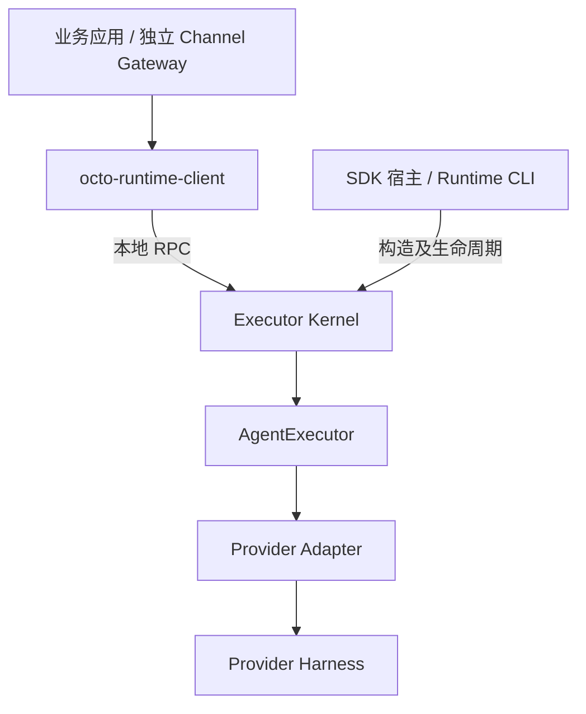

# Octo Runtime 架构

常驻 Engine 的创建、恢复和最终关闭归实际宿主 owner；Adapter 管理调用协议和 lease。默认 Codex owner 由 CLI 服务进程创建，Electron 可注入业务自管依赖；CODEX_HOME 及目录权限归 Home owner。Adapter 构造方式与参数不限，只统一注册执行合同。逐模块对象及生命周期见[架构正文](docs/zh-CN/concepts/architecture.md)。

Runtime 只提供通用 Agent 执行基础设施。业务应用通过公开 client 调用已有 Kernel，或者原生构造并拥有自己的 Kernel。配置来源、模型目录、凭据、会话历史、渠道准入和结果投递由应用负责。

`octo-channel-gateway` 是独立 Git 仓库和 npm package，注册 SDK 为 `ChannelRegistry.register(endpoint, definition)`。定义中的函数和存储留在调用进程；Gateway 自行决定配置方式，Runtime 不定义业务 JSON/schema、不发现渠道、不提供渠道注册 RPC。Gateway 不安装或启动 Runtime。

执行边界采用 inputs 与 agentEnv 分离；业务 extra.* 仅可作为应用自己的格式，Runtime 不定义或渲染。当前 SDK/IPC v2 为用户授权的破坏性变更，保留执行信封结构。

agentEnv 是每次调用的执行配置，不是会话身份：本次调用冻结快照，同一会话下一轮可以使用业务明确选择的新配置，不做跨轮全量签名。异步问题在原执行活动时按原执行身份回答；确认正常完成后的续跑由 Gateway/宿主通过 continuation 授权并提供配置。sessionId、providerSession 和可选 providerEpoch 只核对其明确表达的身份/代次，不能证明工作目录、凭据或其他配置没有变化。业务负责识别 Provider 绑定替换并使旧表单失效；SDK 不把任意 agentEnv 差异判为过期，也不自动识别隐藏的绑定变化。条件和限制见[异步续跑合同](docs/zh-CN/reference/output-and-control.md#续跑配置由应用决定)。

SDK 宿主 import Adapter 对象后调用 `createKernelService({home, endpoint, adapters})`。Kernel 不读取模块清单；CLI 仅管理自己的 Adapter manifest、配置与用户服务。Desktop App 使用 SDK，不通过外部 CLI 包装服务。

每个消费者拥有自己的 client 与执行登记。关闭先停止接纳，在同一绝对期限内取消并消费所属执行、完成业务持久化和投递，最后释放连接。取消受理不等于终态，执行终态不等于投递成功；订阅中断不得自动重放执行。Gateway 关闭不停止共享 Kernel，也不影响兄弟消费者。

Kernel 保留接纳、身份、隔离执行、观察窗口、取消、交互与恢复能力。AgentExecutor 是唯一执行实现。默认推荐 KernelClient；显式选择直接 Core 时，宿主自行承担执行生命周期。运行时状态有界，业务历史归业务存储。

同一操作系统账号内的本地客户端互信。真实认证由宿主和 Harness 管理，凭据不能进入仓库、日志或服务参数。本地执行不以云端登记或 IM 建联为前提。完整 Runtime 与独立 client 继续双包、自包含发行。

边界详见[架构规则](.octospec/rules/architecture.md)，拆分与验收范围见 [Issue 328](.octospec/tasks/328-remove-extra/brief.md)。
