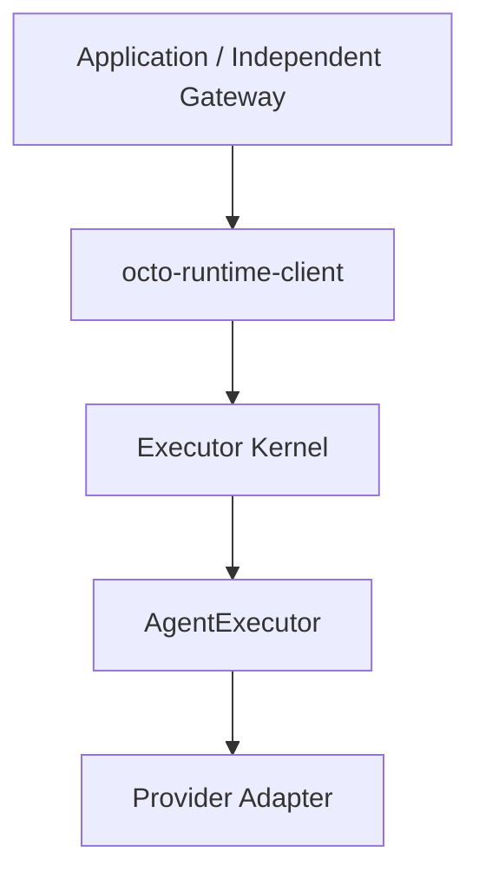

# Architecture

[简体中文](../../zh-CN/concepts/architecture.md)

Runtime provides general execution; applications own business data and host composition lifecycles. Holding a reference does not grant authority to restart or destroy an object, or delete its persistent data.



Gateway is an independent repository and owns configuration, authorization, contexts, sessions and delivery. Closing a registration leaves the shared Kernel running.

Execution event envelopes retain their format. Gateway/applications prepare business inputs; agentEnv contains execution configuration only.

## Current Modules and Object Lifecycles

A closer manages resources it created or explicitly owns; a module dependency does not transfer ownership.

| Module | Objects held or consumed | Lifecycle responsibility |
| --- | --- | --- |
| CLI / Electron host | KernelService, Engine owner, application clients, explicit configuration, process signal handlers | The actual service host constructs, initializes, and closes them; exiting the CLI start client does not close the background service. |
| cross-service | ServiceSpec, platform backend, management commands | CLI/installers request installation and service actions; the OS user service manager manages the background host process, not Provider protocol operations. |
| Host SDK | Home, identity, endpoint helpers, startup diagnostics | Callers choose configuration and persistent-data retention; helpers do not acquire ownership of Kernel or Provider objects. |
| Executor Kernel | Core, RPC server/sockets, Run window, internal client, logs, resource records | KernelService initialize/close manages internal resources; the host that created KernelService performs its final close. |
| Executor Core | Registered adapters, per-registration execution scopes, invocation controllers, iterators, interaction state | Core manages admission, targeted cancellation, invocation cleanup, and scope shutdown; there is no separate execution worker. |
| Adapter SDK | Adapter/scope/cleanup contracts, queue, log and process helpers | Consumers own concrete helper instances; the helper library does not create a global Engine by default. |
| Codex adapter | Injected CodexEngineProvider, scope routes, invocation channels, protocol and interaction state | createCodexAdapter({engine}) does not supervise processes; Core scope shutdown releases local work and leases. |
| ManagedCodexEngine / CodexService | Configuration pool, owned app-server, stdio reader/writer, RPC correlation, recovery timers, incarnation | The host explicitly creates createManagedCodexEngine({codexHome}), holds it and finally closes the owner; channel.close releases one invocation. |
| ACP Client / other Provider adapters | Per-invocation subprocesses, native session queues, or remote connections | Each adapter retains its existing resource model; callers of spawnAcpClient must close the client. Codex ownership does not define every Provider's model. |
| protocol | Schemas, execution envelopes, identity and event types | No runtime ownership of processes or connections. |
| runtime-client | Its own connections, invocation registry, observation and control handles | Consumers stop admission, drain their own invocations, then close the client; close does not cancel accepted work or stop a shared Kernel. |
| Independent Gateway / business application | Inputs, agentEnv, business session bindings, storage and delivery objects | Business consumers own them; closing a registration does not stop a shared service. |

Runtime IPC connects callers to Kernel. Codex stdio JSON-RPC connects the adapter to app-server; these are different connections. Kernel admission readiness does not prove that Codex has started, authenticated, or can complete an invocation.

## Persistent Engine Boundaries: Issue 339

[Issue #339](https://github.com/Mininglamp-OSS/octo-runtime/issues/339) refines the architecture by moving persistent Engine ownership from adapter scopes to hosts. CodexEngineProvider is the Codex-specific access contract. See the [task](../../../.octospec/tasks/339-engine-lifecycle/brief.md) for design and verification. The codexAdapter singleton, default export, and createCodexAdapter({command, env, spawnFn}) are removed without a compatibility layer.

This refinement focuses on adapters that depend on persistent processes. An adapter owns protocol adaptation and its registered execution contract; Engine supervision is an explicit host composition choice.

### Unrestricted Adapter Construction

Runtime **must not constrain adapter construction methods, parameter count, parameter types, parameter order, or dependency injection forms**. Implementers may use class constructors, factories with any signature, closures, or directly assembled objects. Hosts may supply a concrete client, configuration, a connection pool, an SDK instance, functions, multiple objects, or any other dependencies. A client-only signature, common options object, or shared Engine base class is not required.

For example, Electron can maintain a black-box AgentEngine's XxxClient and its connections, then pass that client or other dependencies according to the custom adapter's construction contract. That adapter decides argument semantics and validation. Runtime receives the already-constructed adapter and requires only the public registered execution contract; it does not inspect business constructor arguments or add Core/Kernel branches for that Engine.

CLI manifest configuration and factory invocation conventions belong to CLI composition, not SDK adapter construction. SDK hosts need not serialize live objects into a manifest, agentEnv, or RPC, or implement Codex-specific provider/channel/lease interfaces.

Construction freedom preserves the execution contract: adapters must still correctly report events and handle supported interactions, cancellation, and cleanup. Supplying an object, or an object exposing close, does not transfer ownership. Shared connections and Engines remain managed by the owner explicitly agreed between the host and adapter.

### Ownership of Persistent Objects

| Object | Creation and shutdown responsibility | Borrower authority |
| --- | --- | --- |
| Default managed Codex owner, configuration pool, and processes | The actual CLI service host creates and finally closes them; supervision is a reusable module. | The adapter acquires an invocation channel without owner.close/restart authority. |
| Existing application Engine and shared connection | The existing Electron/business owner manages startup, recovery, shutdown, and connection correlation. | The adapter uses supplied access without duplicate spawning, shared-reader shutdown, or independent Engine recovery. |
| Adapter scope | Core creates and closes a scope per registration; the scope manages its own routes, subscriptions, and leases. | Scope close releases local resources without stopping sibling invocations or the shared Engine. |
| Invocation channel / lease | The provider allocates it; the adapter releases it after completion, cancellation, or cleanup. | Release is idempotent and invocation-specific; closing a dedicated connection requires explicit provider authorization. |
| CODEX_HOME directory, permissions, and persistent data | The Home owner selects, prepares, and explicitly injects it, and decides access, retention, migration, and deletion. | The adapter consumes configuration; process or lease shutdown does not authorize permission changes or deletion of authentication, configuration, skills, or native sessions. |

Default CLI composition creates the managed owner and passes owner.provider to the adapter. Electron may supply its own CodexEngineProvider with the same protocol adaptation. Compatible executable, cwd, environment, Home and MCP settings select an app-server; provider.acquire returns an invocation channel and configuration.mcpServers. channel.close must be idempotent and invocation-specific. Shared connections require coordinated RPC IDs and notification routing; two Runtime instances must not independently read the same stdio stream. Other adapters need not implement this Codex-specific contract.

doctor renders process ownership using owner_pid: the default app-server belongs under the CLI host (Host/Kernel PID), with no Adapter PID node. Kernel accepts safe host snapshots through serviceProcesses; Core.processes does not claim borrowed Codex Engines. Application-owned snapshots retain the actual owner_pid and ownership. Observation never grants control authority.

### CODEX_HOME and Process Lifetimes

SDK hosts must supply an absolute codexHome; missing or relative paths fail with CODEX_HOME_REQUIRED. The CLI host factory chooses options.codexHome, then the service process CODEX_HOME environment, then ~/.codex. Adapter and supervision code never select another Home. agentEnv carries no live owner object; conflicting invocation overrides fail with CODEX_HOME_CONFLICT. Hosts needing multiple Homes compose and route them explicitly.

Runtime Home contains Kernel state; CODEX_HOME contains Codex data. The Home owner and process owner may differ. Stopping or recovering app-server, closing Kernel, cancelling work, or uninstalling a service does not authorize Runtime to delete CODEX_HOME. Authorized native Provider reads and writes do not grant directory-management authority to the adapter. Directory access does not prove authentication or create a security sandbox within the same OS account.

### Shutdown and Failure

Hosts may explicitly supply finalizeHostResources(deadline). Kernel awaits this callback after Core/Run drain and before releasing persistent ownership evidence. CLI's callback closes its own assembly. Failure retains cleanupFailed and the endpoint lease rather than declaring complete shutdown while an Engine remains. This coordinates host cleanup without transferring Engine authority to adapters. The managed SDK example also supplies this callback; borrowers never register a shared owner's disposer.

The host stops local admission and acquisition, cancels and drains its work, closes Kernel/Core resources and releases leases, then closes owned Engines. CLI calls owner.beginShutdown, kernel.close, then owner.close({deadline}) within one five-second budget; deadline is absolute performance.now() milliseconds. SDK hosts owning an exclusive owner follow the same order. Borrowers close only their own Kernel, never owner.beginShutdown/close, so other consumers can continue acquiring the shared Engine.

Initialization failure rolls back only resources created by that composition, without destroying an injected shared owner. Timeouts, release failures, and unconfirmed process exits remain distinct; independent cleanup still runs after another disposer fails. Managed Engines recover through their owner; application Engines recover through the business owner. Recovery never replays accepted turns, tool actions, or interaction decisions, or routes stale interactions into a new incarnation.

## AgentEnv Goes Directly to the Adapter

Callers construct `inputs` and `AgentEnv`. The envelope contains only `schema` and `items`. Core snapshots it for each invocation, reads the Adapter route, and forwards all items with their values and order intact. It does not derive a second configuration object or interpret Harness-specific settings. Runtime owns execution, cancellation, watchdogs and cleanup; the Adapter reads and validates configuration, applies its defaults and maps settings to the Provider.

Only shared concepts, such as model, reasoning effort and approval policy, have public protocol beans. `adapter-sdk` provides item readers, composition helpers and shared-setting helpers. Managed Adapters expose an independent `defaultAgentEnv` for callers to build on. Invocation does not append default items to the submitted envelope.

For OpenClaw, the target Agent is a private agreement between the host and the OpenClaw Adapter:

```json
{
  "schema": "octo.context-envelope/v3",
  "items": [
    { "namespace": "octo.execution", "name": "adapter", "payload": { "type": "openclaw" } },
    {
      "namespace": "octo.execution",
      "name": "model",
      "payload": { "selection": { "id": "provider/model" }, "reasoning": { "effort": "high" } }
    },
    { "namespace": "adapter.openclaw", "name": "options", "payload": { "agentId": "researcher" } }
  ]
}
```

The public protocol defines the envelope and shared beans. The name, fields, types, defaults and validation of `adapter.openclaw/options` belong exclusively to the host and OpenClaw Adapter. This example does not make them public protocol fields. Core forwards the item; OpenClaw reads `agentId`; other Adapters ignore it. Adding private settings or a custom Harness requires only the caller's item and its consuming Adapter, without a public schema registration, public type or protocol-version change. Private items are not rendered into model input.

Trusted connection credentials travel through the local Adapter context. Envelope validation checks structure, unique keys, JSON depth and size; the consuming Adapter reports semantic errors in recognized settings.

## Execution Configuration and Session Identity

agentEnv is snapshotted per invocation, not required to remain equal across a session. Runtime does not fingerprint it for cross-run equality. Applications may explicitly select new effort, environment variables, MCP settings, permissions or a workdir for the next run; execution validation and Provider configuration/resume limitations still apply.

An answer to an active async question targets the original run; new configuration cannot redirect it. After confirmed normal completion, Gateway/the host decides whether to continue and which agentEnv to use. Hosts choosing AsyncQuestionReply authorize that next run through the continuation callback; the SDK does not decide whether global “current configuration” is appropriate for an old question.

providerEpoch is an optional application binding version, not an agentEnv edit counter. When used, increment it on binding replacement and save the original value with the question snapshot. Otherwise, the host must invalidate forms belonging to a replaced binding itself. Never pass an old providerSession to another Adapter, account or server that does not share that session identity. SDK checks cover explicit identities/generations, not hidden configuration changes. See [continuation configuration](../reference/output-and-control.md) and [identifiers](identifiers.md).
