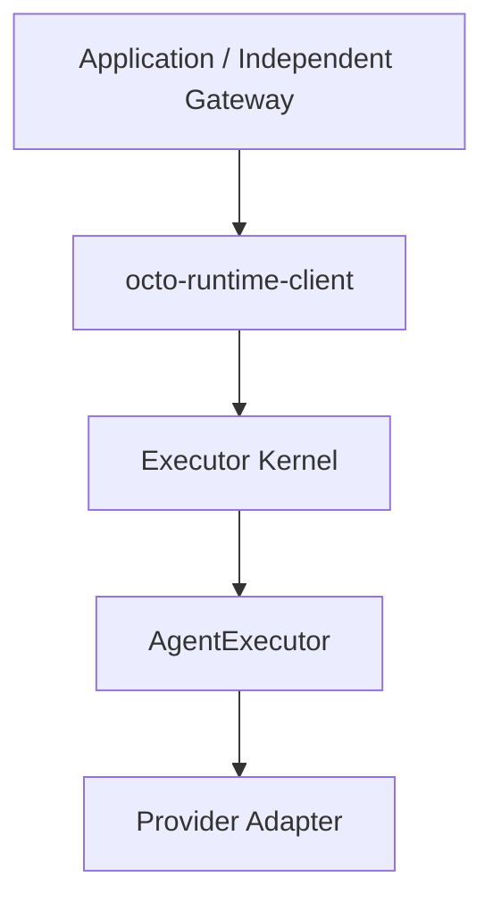

# Architecture

[简体中文](../../zh-CN/concepts/architecture.md)

Runtime provides general execution; applications own business data and lifecycle.

Gateway is an independent repository and owns configuration, authorization, contexts, sessions and delivery. Closing a registration leaves the shared Kernel running.

Execution event envelopes retain their format. Gateway/applications prepare business inputs; agentEnv contains execution configuration only.

## Execution Configuration and Session Identity

agentEnv is snapshotted per invocation, not required to remain equal across a session. Runtime does not fingerprint it for cross-run equality. Applications may explicitly select new effort, environment variables, MCP settings, permissions or a workdir for the next run; execution validation and Provider configuration/resume limitations still apply.

An answer to an active async question targets the original run; new configuration cannot redirect it. After confirmed normal completion, Gateway/the host decides whether to continue and which agentEnv to use. Hosts choosing AsyncQuestionReply authorize that next run through the continuation callback; the SDK does not decide whether global “current configuration” is appropriate for an old question.

providerEpoch is an optional application binding version, not an agentEnv edit counter. When used, increment it on binding replacement and save the original value with the question snapshot. Otherwise, the host must invalidate forms belonging to a replaced binding itself. Never pass an old providerSession to another Adapter, account or server that does not share that session identity. SDK checks cover explicit identities/generations, not hidden configuration changes. See [continuation configuration](../reference/output-and-control.md) and [identifiers](identifiers.md).
