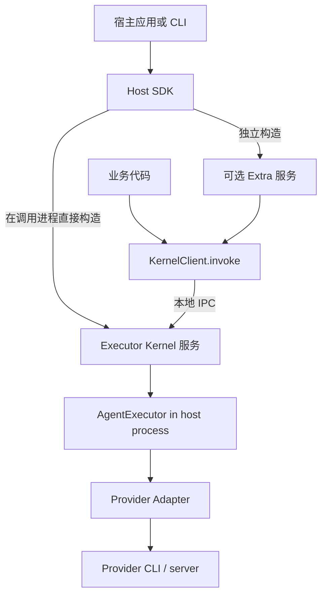
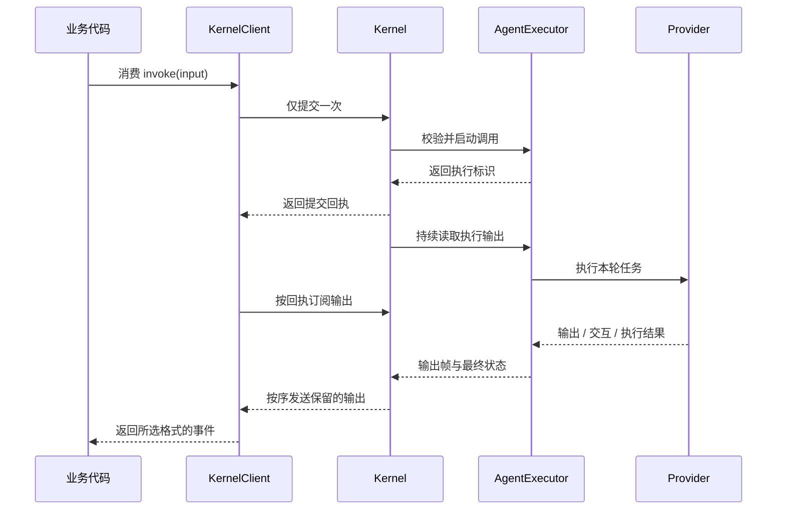

# 核心架构

[English](../../en/concepts/architecture.md) | [文档目录](../README.md)

Octo Runtime 让应用通过统一接口调用 Codex、Claude Code 等 Agent 执行程序。本文将这些程序称为 **Provider**，将接入 Runtime 的应用称为**宿主应用**。每个 Provider 对应一个 **Adapter**，负责转换输入、输出和控制消息。

标准业务调用统一使用 KernelClient.invoke，经本地 RPC 进入 Kernel；Kernel 在宿主进程持有 AgentExecutor 和宿主注入的 Adapter。

根目录[架构文档](../../../ARCHITECTURE.md)介绍了这一设计的背景：IM、桌面应用和任务系统共用一套执行能力，无需各自实现 Provider 接入。

当前 Kernel 提供本地进程间通信（IPC）。IM 等业务入口通过可选的 Extra 接入。根文档中描述的云端设备注册、远程寻址和跨设备会话路由仍是目标设计，当前公开 Kernel 接口没有实现这些能力。

createKernelService 在调用进程创建 Kernel、AgentExecutor 与 RPC 端点；原生宿主无需运行 Runtime CLI，使用 kernel.client 调用服务。另一个进程中的独立应用通过 attachKernel 连接已有 Kernel。

CLI 用 Home 目录保存设备实例的身份和配置，用 workdir 指定 Agent 工作目录，两者用途不同。使用 SDK 的应用自行决定配置和状态存放位置。

## 职责划分

Adapter 与 Extra 由接入入口选择。SDK 宿主原生 import 和组装，不依赖 manifest；CLI 使用同时包含 adapters、extras 的统一清单，读取内置目录和 Runtime Home 扩展。默认发行继续保留全量集合。完整约束、解析锚点和验证范围见 [Adapter 与 Extra 载入](module-loading.md)。

| 组件             | 负责                                                                  | 不负责                           |
| ---------------- | --------------------------------------------------------------------- | -------------------------------- |
| 宿主应用         | 安装和认证 Provider，提供配置、业务历史和数据库，管理服务的启动与关闭 | 转换 Provider 协议               |
| Host SDK         | 创建 Kernel 和 Extra 服务，传入依赖，报告初始化和清理结果             | 管理应用数据库的表结构和迁移     |
| Executor Kernel  | 提供 IPC 接口，管理 Core 与 Run 生命周期，暂存输出以支持断线后补读                  | 保存业务历史或自动重跑请求       |
| AgentExecutor    | 准备输入，驱动一次执行，处理交互、取消和最终状态                      | 查询业务背景或安装 Provider      |
| Provider Adapter | 将 Runtime 参数转换为 Provider 配置，处理原生输出并清理执行资源       | 决定业务权限或补齐聊天历史       |
| Extra            | 接收业务请求，加载 Context，调用 Kernel，向业务系统投递结果           | 关闭共享 Kernel 或其他模块的调用 |

本地 SDK 调用可以只使用 Kernel，不需要 Extra、云端登录或 IM 连接。`octo-runtime` 是启动和管理 Runtime 的 CLI；`octo-cli` 则是独立的业务 API 工具。如果 Agent 需要调用 `octo-cli`，应用需要另外安装并配置凭据。

Provider harness 的登录、授权及凭据准备归使用者、宿主与 harness。Runtime 传递普通执行环境并完成必要的协议握手，包括使用 harness 广告的受支持方式进行 ACP 认证；不检查 Provider 专属认证环境变量或凭据文件，不因某个变量缺失而推断未登录，也不代办登录和凭据刷新。harness 自行解析认证来源并判断认证是否成功，Runtime 如实返回失败。框架自身安全及 Extra 显式业务凭据合同仍按各自规则执行。

## 模型目录与选模归属

模型目录等业务数据可以由宿主直接查询和传递，也可以由 Extra 调用宿主通过 `dependencies` 注入的函数来处理。两种方式均与 Kernel 无关，Extra 不是必经入口，也不要求 Provider 增加依赖扩展机制。接入方式见[Extra 指南](../guides/extras.md)。

模型目录由 Provider 及其实际后端定义；接入宿主选择目录来源并管理展示。Runtime 负责按执行合同传递显式模型、完成原生适配并返回实际结果，不提供统一模型/effort 目录服务。

例如，同一个 Codex harness 和 Adapter 可能连接官方服务、第三方代理站或自定义 endpoint。不同后端或账号可能使用不同的模型 ID、别名、默认值和推理选项。兼容同一种执行协议不代表提供模型枚举接口，官方模型列表也不能代表代理站。不能从 CLI 名称、版本或 Adapter 可用状态推导模型集合。

| 责任方                    | 负责什么                                                                                      |
| ------------------------- | --------------------------------------------------------------------------------------------- |
| Provider / 服务或代理后端 | 原生模型标识、可选查询接口及其语义、执行时的真实接受或拒绝                                    |
| 接入宿主                  | endpoint 和账号配置，选择后端查询、管理员配置或用户输入作为选项来源，管理刷新、失败及界面展示 |
| Runtime / Adapter         | 显式执行输入的原生映射、必要协议校验和结果返回                                                |

宿主没有可靠目录时，可以按产品需要允许手工输入、只展示 Provider 默认或说明目录不可用。Runtime 不通过静态列表、私有凭据扫描、额外登录或探测会话补齐目录，也不把目录缺失等同于不能执行显式模型。

这不取消 Provider 原生协议的约束。例如 CodeBuddy 在执行会话中要求按原生广告目录选择并确认模型，Adapter 仍须执行这些步骤；但会话内校验不构成公共目录服务。省略模型时保留既有默认语义，effort 仍按既有映射报告实际应用情况，不承诺目录内模型对当前账号一定可调用。

[Issue 193](https://github.com/Mininglamp-OSS/octo-runtime/issues/193) 是这一边界的典型案例：客户端需要模型选择器，不意味着执行基础设施需要生产模型目录。此责任划分不因某个 Provider 新增查询接口而自动改变。工程约束见 [Octospec 架构规则](../../../.octospec/rules/architecture.md)，IPC 边界见 [Kernel IPC](../reference/kernel-ipc.md)。

## Channel Context 与历史

Channel Gateway 负责 IM Context 的稳定规则、当前消息事实和历史查询。Host SDK、Kernel、Core、renderer 与 Provider Adapter 消费已提交输入，不自行选择或去重业务历史；OpenClaw、Codex、Claude Code 共用该责任边界。

稳定 mention、产物格式和历史理解指引在第 1 轮及每 N 轮携带（`stable_context_refresh_interval_turns`，默认 30）；reset/new 重置计数，新 Provider 会话获得完整规则。独立 `message-trigger` 描述每条真实入站消息。群/子区规则按范围及版本更新，清空时明确 `NO RULES`。周期刷新不保证轮间始终记住规则，也不监听模型压缩。

自动历史选取同频道当前触发前最近最多 **20 条消息**，从旧到新呈现。**完整序列化 `messages` 数组最多 8000 Unicode 码点**，包括身份、时间、JSON 结构及转义，属于整个数组的总预算。冷启动和缺口准备共用本轮一次有界读取，主历史与 fresh fallback 恢复补充共用同一窗口和预算。

首轮、reset、补位或连续性未知的历史保留自身 Bot 消息。确认正常续接时，Gateway 才可依据完成状态、归属、投递位置和内容指纹，省略已由同一 Provider 会话 assistant 覆盖的具体成功输出；本次 fresh fallback 从冻结窗口补回。不按 UID、正文或 URL 全面去重，不删除引用/转发内部消息，不过滤显式宿主 Context。

接入说明见[会话准备](../guides/context-and-sessions.md)，权威合同见 [Octospec 架构约束](../../../.octospec/rules/architecture.md)。

## 调用时序

提交回执表示请求已经被接收，执行结果还要从输出流中读取。客户端断线后，已提交的执行仍会继续。重连时客户端查询原执行，并补读 Kernel 尚未清除的输出，不会重新发起调用。若宿主退出，客户端按失联合同报告未知结果；重建服务不重跑原请求。

## 原生装配与统一 RPC

Electron 主进程原生 import 并构造 Adapter，CLI 则由自己的装配层读取 manifest、动态 import 并调用工厂。两者都将实际对象传入 `createKernelService({ home, endpoint, adapters })`，等待 `initialize()`，再通过 `kernel.client` 执行业务。Kernel 不接受清单、模块路径或执行 worker 入口，不加载产品模块。

`endpoint` 是本地通信地址；Home 是宿主配置目录，`componentEndpoint(home)` 只是地址派生函数。同进程不省略 RPC：业务和 Extra 统一走 `KernelClient -> RPC -> Kernel -> AgentExecutor -> Adapter`。对象注入属于装配，RPC 传递调用数据；方法和闭包无需经过 RPC。

Kernel 保留接纳、身份检查、有界源窗口、交互、取消与关闭管理。客户端停止观察不取消执行；丢失 ACK 后查询原身份，不能重跑请求。直接 Core 仅供底层实现和专项测试，不是 Electron/CLI 的另一种标准入口。

## 故障边界与关闭

Kernel、Core 和 Adapter 共享宿主事件循环；RPC 不提供进程崩溃隔离。已删除 worker 心跳、自动重启和 worker generation 状态。Adapter 内部仍可按 Provider 协议启动和回收子进程。宿主崩溃或 OOM 后不能承诺本进程继续服务；宿主重建服务产生新的 `kernel_instance_id`，旧 Run 不自动重放。

初始化成功后才开放业务入口。退出先停接纳、关闭自己拥有的 Extra、排空业务尾流，再关闭 Kernel。Kernel 在共用 5 秒截止时间内取消 Core、等待 Adapter 清理并回收端点。`complete=false` 保留未确认清理事实；终态、取消 ACK 和资源回收是三个独立事实。无法强杀同进程阻塞代码，绝对期限只对仍可调度的事件循环有效。

## 访问权限

本地 IPC 假定同一操作系统账号下的客户端可信，POSIX socket 权限为 `0600`。如果应用接收远程业务请求，需要自行认证用户并检查资源权限。workdir 只是工作目录，不会限制 Provider 对其他文件或网络的访问。

Windows 上父进程退出或应用被强制终止后，部分后代进程可能无法继续跟踪和回收。判断清理结果时需要考虑这一平台限制。

实现：[service](../../../packages/octo-runtime-executor-kernel/src/service.ts)、[server](../../../packages/octo-runtime-executor-kernel/src/server.ts)、[Core](../../../packages/octo-runtime-executor-core/src/index.ts)、[Extra service](../../../packages/octo-runtime-host-sdk/src/extra-service.ts)。
