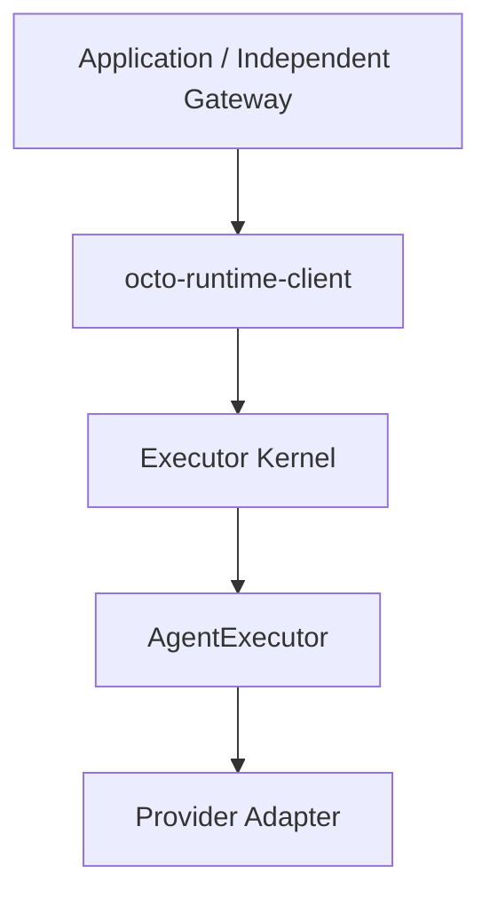

# 架构

[English](../../en/concepts/architecture.md)

Runtime 提供通用执行，应用持有业务数据和宿主装配的生命周期。持有对象引用不等于拥有该对象的重启、销毁或持久数据删除权限。



Gateway 为独立仓库，配置、授权、上下文、会话和投递由其负责。关闭业务注册不停止共享 Kernel。

执行事件信封保持原格式；业务材料由 Gateway/应用准备 inputs，agentEnv 仅包含执行配置。

## 当前模块与对象生命周期

表中的关闭者只负责自己创建或明确拥有的资源，不能从模块依赖推导所有权转移。

| 模块 | 持有或消费的对象 | 生命周期由谁维护 |
| --- | --- | --- |
| CLI / Electron 宿主 | KernelService、Engine owner、应用 client、显式配置、进程信号 handler | 实际运行服务的宿主负责构造、初始化和最终关闭；CLI start 客户端退出不关闭后台服务 |
| cross-service | ServiceSpec、平台 backend 与管理命令 | CLI/安装器发起安装、启停；OS 用户服务管理器维护后台宿主进程，不负责 Provider 协议 |
| Host SDK | Home、identity、endpoint 辅助值与启动诊断 | 调用者决定配置和持久数据保留；辅助函数不因此拥有 Kernel 或 Provider |
| Executor Kernel | Core、RPC server/socket、Run 窗口、内部 client、日志和资源记录 | KernelService initialize/close 管理内部资源；最终由创建 KernelService 的宿主关闭 |
| Executor Core | 已注册 Adapter、每注册执行 scope、调用控制器、迭代器和交互状态 | Core 管理接纳、定向取消、调用清理及 scope.beginShutdown/close；本进程内没有独立执行 worker |
| Adapter SDK | Adapter/scope/cleanup 合同，队列、日志及进程辅助对象 | 使用方维护具体实例；辅助库不默认创建全局 Engine |
| Codex Adapter | 注入的 CodexEngineProvider、本 scope 调用路由、本轮 channel、协议与交互状态 | createCodexAdapter({engine}) 不托管进程；Core 关闭 scope 只释放本地调用与 lease |
| ManagedCodexEngine / CodexService | 单个 owned app-server、stdio reader/writer、RPC 关联、恢复 timer 和 incarnation | 宿主显式 createManagedCodexEngine({command, env, codexHome})，持有并最终 close owner；channel.close 只释放本轮资源 |
| ACP Client / 其他 Provider Adapter | 逐轮子进程、原生会话队列或远端连接 | 各 Adapter 按已有模型释放本轮资源；调用 spawnAcpClient 的一方负责 client.close；不能由 Codex 模型推导全部 Provider |
| protocol | Schema、执行信封、身份和事件类型 | 没有进程或连接的运行期所有权 |
| runtime-client | 自己的连接、调用登记、观察及控制句柄 | 消费者停止接纳、排空自己调用，再关闭 client；close 不等于取消已接纳执行或关闭共享 Kernel |
| 独立 Gateway / 业务应用 | inputs、agentEnv、业务会话绑定、存储和投递对象 | 业务方维护；关闭业务注册不停止共享服务 |

Runtime IPC 是调用方到 Kernel 的本地 RPC。Codex stdio JSON-RPC 是 Adapter 到 app-server 的另一段连接，两者不是同一个端点。Kernel 可接纳调用不证明 Codex 已启动、已认证或本轮会成功。

## 常驻 Engine 边界细化：Issue 339

[Issue #339](https://github.com/Mininglamp-OSS/octo-runtime/issues/339) 将常驻 Engine 所有权从 Adapter scope 移到宿主；这是架构边界细化。Codex 专用访问合同为 CodexEngineProvider。完整设计与验证见[任务](../../../.octospec/tasks/339-engine-lifecycle/brief.md)。旧 codexAdapter 单例、默认导出和 createCodexAdapter({command, env, spawnFn}) 已删除，不提供兼容层。

本次聚焦依赖常驻进程的 Adapter。Adapter 负责协议转换和注册后的执行合同；Engine 托管是宿主选择的装配方式。

### Adapter 构造方式不受 Runtime 限制

Runtime **不得限制 Adapter 的构造方法、参数数量、参数类型、参数顺序或依赖注入形式**。Adapter 实现者可以使用类构造函数、任意签名的工厂、闭包或直接构造对象。宿主可以传具体 client，也可以传配置、连接池、SDK 实例、函数、多个对象或其他任意依赖；不要求只传 client、统一 options 对象或统一 Engine 基类。

例如，Electron 自己维护黑盒 AgentEngine 的 XxxClient 和连接生命周期，把该 client 或其他依赖按专用 Adapter 的构造约定传入即可。构造参数的具体含义和校验由该 Adapter 决定。Runtime 接收构造完成的 Adapter，只要求结果满足公开的注册执行合同，不检查业务构造参数，不按黑盒 Engine 类型增加 Core/Kernel 分支。

CLI manifest 对工厂的配置和调用约定只是 CLI 的装配机制，不是 SDK Adapter 构造规范。SDK 不需要把存活对象序列化到 manifest、agentEnv 或 RPC，也不需要实现 Codex 专用的 provider/channel/lease 接口。

构造自由不改变执行合同：Adapter 仍须正确返回事件、处理支持的交互/取消及清理。对象传入或对象存在 close 方法，不表示所有权转移。共享连接及 Engine 的生命周期由宿主与 Adapter 明确约定的 owner 维护。

### 常驻对象的所有权

| 对象 | 创建与关闭责任 | 借用方可以做什么 |
| --- | --- | --- |
| 默认 Codex 托管 owner 与单个 app-server | CLI 的实际服务宿主创建并最终关闭；默认同类型 Harness 一个实例 | Adapter 获取本轮 channel，不获得 owner.close/restart 权限 |
| 业务已有 Engine 与共享连接 | Electron/业务既有 owner 维护启停、恢复和连接关联器 | Adapter 仅使用宿主提供的访问依赖；不能重复 spawn、关闭共享 reader 或自行恢复 Engine |
| Adapter scope | Core 为每次注册建立并关闭；scope 管理自身路由、订阅与租约 | scope.close 释放本 scope 资源，不停止兄弟调用或底层共享 Engine |
| 本调用 channel / lease | provider 分配，Adapter 在本轮结束、取消或清理时释放 | release 幂等且限于本调用；关闭独占连接须由 provider 合同明确授权 |
| CODEX_HOME 目录、权限与持久数据 | Home owner 选择、准备并显式注入，维护访问权限、保留/迁移/删除策略 | Adapter 只消费配置；关闭进程或 lease 不授权改权限或删除认证、配置、skills、原生会话 |

默认 CLI 由宿主装配托管对象，再将 owner.provider 交给 Codex Adapter。每种受管 Harness 默认只有一个实例，Codex owner 内只有一个 app-server；cwd、环境、MCP、模型、容量及并发数量不触发分池。provider.acquire 返回本轮 channel、configuration.mcpServers 与 configuration.config；thread/turn 承载每轮参数。owner 不按 Agent 数量或估算的 lease 内存设置接纳门槛。账户等强隔离必须由宿主显式选择独立 owner。Electron 可以注入业务自管的 CodexEngineProvider，复用相同协议适配。channel.close 幂等且只有本轮释放权；共享连接必须有统一 RPC ID 和通知关联器，不能让两个 Runtime 各自独立读取同一 stdio。这是 Codex 专用访问接口，不限制其他 Adapter 的构造方式。

doctor 按 owner_pid 展示 CLI Host 拥有平级的 Kernel 和 app-server。Kernel 标明 in-process 并共用宿主 PID，不虚构独立进程；Adapter 不是 PID 树节点。Kernel 的 serviceProcesses 回调只接收宿主提供的安全快照；Core.processes 不把借用的 Codex Engine 声称为自有资源。Electron 自管 Engine 的快照须保留实际 owner_pid 与 ownership；只读展示不授予控制权限。

### CODEX_HOME 与进程生命周期分别维护

SDK 必须在装配时显式提供绝对路径 codexHome；缺失或相对路径以 CODEX_HOME_REQUIRED 拒绝。CLI 在宿主工厂选择 options.codexHome、服务进程环境 CODEX_HOME，最后默认 ~/.codex。Adapter 和托管库不隐式选其他 Home。agentEnv 不携带存活 owner；与宿主绑定 Home 冲突的逐轮覆盖以 CODEX_HOME_CONFLICT 拒绝。需要多 Home 时由宿主分别装配并路由。

Runtime Home 用于 Kernel 自身状态；CODEX_HOME 用于 Codex 数据。Home owner 与进程 owner 可以不同。停止、恢复 app-server，关闭 Kernel，取消调用或卸载服务都不授权 Runtime 删除 CODEX_HOME。Provider 按授权正常读写自己的数据不等于 Adapter 获得目录管理权。目录可访问也不证明认证成功，不能把同 OS 账号下的权限当成额外沙箱。

### 关闭与故障

宿主可显式传 finalizeHostResources(deadline) 收尾回调。Kernel 在 Core/Run 排空后、释放持久所有权记录前等待此回调；CLI 回调调用自己持有的 assembly.close。失败则保留 cleanupFailed 与端点租约，不把 Engine 未退出记录成完整关闭。这是宿主收尾协调接口，不向 Adapter 转移 Engine 管理权。SDK 完整托管示例也提供该回调；借用业务 Engine 的 Kernel 不登记共享 owner 的 disposer。

关闭顺序由宿主协调：停止本装配接纳和新资源获取，取消并排空自己调用，关闭 Kernel/Core 本地资源并释放租约，最后由 owner 关闭 owned Engine。CLI 先 owner.beginShutdown 停获取/恢复，再 kernel.close，最后 owner.close({deadline})；deadline 为 performance.now() 绝对毫秒，共享 5 秒预算。SDK 独占 owner 也遵循此顺序。借用共享 owner 的 Runtime 仅关闭自己的 Kernel，不调用 owner.beginShutdown/close，其他消费者仍可获取资源。

初始化失败只回收本装配已创建的资源；注入的共享 owner 不参与销毁。超时、release 失败和未确认进程退出分别记录，前项失败仍尝试其他独立清理。托管 Engine 由其 owner 恢复，业务 Engine 由业务 owner 恢复；恢复不自动重放 turn、工具动作或交互决定，也不把旧交互发送到新 incarnation。

## 接入场景与按需装配约束

| 场景 | 依赖与入口 | 所有权及加载范围 |
| --- | --- | --- |
| CLI 执行服务 + 独立 App | CLI 安装 `octo-runtime` 并启动；App 仅安装 `octo-runtime-client`，通过 `attachKernel({ endpoint })` 调用 | CLI 拥有 Kernel 和内置 Harness；App 不加载 Adapter、不启动 Provider，关闭 client 不停止服务 |
| 应用内纯原生嵌入 | 从源码 workspace 依赖 Kernel/Core、公共辅助包及所选 Adapter，直接按包名 import | 应用拥有服务及明确创建的 Engine；只需 Codex 就不依赖 OpenClaw，只需 OpenClaw 就不依赖 Codex |

纯原生接入不依赖完整 CLI 包的 Adapter 聚合导出；源码包保持 private，不作为独立 npm 产品发布。宿主通过 `workspace:*` 声明所需源码依赖，按产品配置选择 import 或动态 import，在 Kernel 初始化前完成 Adapter 构造和注册。Runtime 不扫描、安装或自动补齐未选择的 Adapter；也不要求新增统一 Engine 接口。依赖声明及完整示例见 [SDK 接入](../getting-started/sdk.md)。

按需模块加载与进程惰性启动分别定义：源码宿主选择需要加载的 Adapter；当前 CLI 会加载其 manifest 的全部装配项。Codex owner 的 app-server 在首次调用时启动，同 owner 内各 cwd、模型及配置共用单进程。CLI 发行仍包含自己的内置依赖，这不意味着源码宿主必须携带整套依赖。client 始终只负责 RPC，不能把它变成 Adapter 宿主。

## AgentEnv 直接交给 Adapter

调用方构造 `inputs` 和 `AgentEnv`。`AgentEnv` 只有 `schema`、`items`；Core 为本次调用复制快照，仅读取 Adapter 路由，按原值和原顺序交给 Adapter。Core 不提取另一套执行配置，也不解释 Harness 私有字段。执行、取消、超时和资源清理由 Runtime 负责；配置读取、校验、默认值及 Provider 原生映射由 Adapter 负责。

只有跨 Harness 共用的概念，例如模型、思考强度和审批策略，才在公共协议中定义 bean。`adapter-sdk` 提供 item 读取、组合及共性配置帮助函数。内置 Adapter 暴露可独立修改的 `defaultAgentEnv`，调用方可据此构造请求；执行时不向原信封追加默认条目。

以 OpenClaw 为例，目标 Agent 是宿主与 OpenClaw Adapter 的私有约定：

```json
{
  "schema": "octo.context-envelope/v3",
  "items": [
    { "namespace": "octo.execution", "name": "adapter", "payload": { "type": "openclaw" } },
    {
      "namespace": "octo.execution",
      "name": "model",
      "payload": { "selection": { "id": "provider/model" }, "reasoning": { "effort": "high" } }
    },
    { "namespace": "adapter.openclaw", "name": "options", "payload": { "agentId": "researcher" } }
  ]
}
```

公共协议只定义信封和公共 bean；上例 `adapter.openclaw/options` 的名称、字段、类型、默认值及校验均归宿主与 OpenClaw Adapter，不属于公共协议。Core 保序透传，OpenClaw Adapter 自己读取 `agentId`，其他 Adapter 忽略该私有 item。新增 OpenClaw 专属参数或定制 Harness 时，只需宿主构造对应 item、对应 Adapter 消费，无须注册公共 schema、增加公共类型或修改协议版本。私有 item 不会自动进入模型输入。

Adapter 使用 `agentEnvItem<T>(req.agentEnv, namespace, name)` 读取私有 payload；泛型不执行运行时校验。宿主构造、Adapter 校验和公共 `invocationModel` 读取的完整示例见 [SDK 接入](../getting-started/sdk.md)。

连接认证等宿主可信配置由本地 Adapter 上下文提供，不写进示例或模型正文；信封仅接受结构、唯一键、JSON 深度及大小等通用检查，已识别配置的语义错误由消费它的 Adapter 报告。

## 执行配置与会话身份

agentEnv 按次调用冻结，不要求同一会话各轮相等，也不做跨轮全量签名。业务可明确选择下一轮的 effort、环境变量、MCP、权限或工作目录；执行校验和 Provider 的配置/恢复限制仍然有效。

异步问题在原 Run 活动时，回答定位原执行，不读取新配置来重定向它。原 Run 确认正常完成后，是否续跑及使用哪份 agentEnv 归 Gateway/宿主。宿主选择使用 AsyncQuestionReply 时，通过 continuation 回调明确授权下一轮；SDK 不替业务判断“当前配置”是否仍适合旧题。

providerEpoch 是可选的业务绑定版本，不是 agentEnv 修改计数。使用时在绑定替换后递增，并把原值保存在问题快照中；未使用时，宿主自己使旧绑定的表单失效。不能把旧 providerSession 交给另一个 Adapter、账号或不共享该会话身份的服务端。SDK 只核对显式身份/代次，不承诺自动发现隐藏的配置变化。详见[续跑配置合同](../reference/output-and-control.md)和[标识含义](identifiers.md)。
