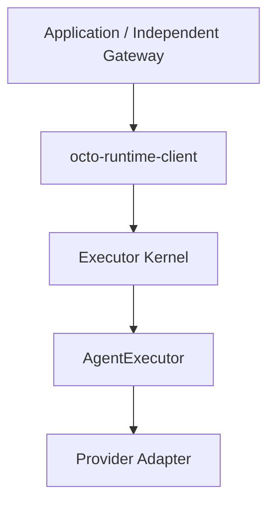

# 架构

[English](../../en/concepts/architecture.md)

Runtime 提供通用执行，应用持有业务数据和生命周期。

Gateway 为独立仓库，配置、授权、上下文、会话和投递由其负责。关闭业务注册不停止共享 Kernel。

执行事件信封保持原格式；业务材料由 Gateway/应用准备 inputs，agentEnv 仅包含执行配置。

## 执行配置与会话身份

agentEnv 按次调用冻结，不要求同一会话各轮相等，也不做跨轮全量签名。业务可明确选择下一轮的 effort、环境变量、MCP、权限或工作目录；执行校验和 Provider 的配置/恢复限制仍然有效。

异步问题在原 Run 活动时，回答定位原执行，不读取新配置来重定向它。原 Run 确认正常完成后，是否续跑及使用哪份 agentEnv 归 Gateway/宿主。宿主选择使用 AsyncQuestionReply 时，通过 continuation 回调明确授权下一轮；SDK 不替业务判断“当前配置”是否仍适合旧题。

providerEpoch 是可选的业务绑定版本，不是 agentEnv 修改计数。使用时在绑定替换后递增，并把原值保存在问题快照中；未使用时，宿主自己使旧绑定的表单失效。不能把旧 providerSession 交给另一个 Adapter、账号或不共享该会话身份的服务端。SDK 只核对显式身份/代次，不承诺自动发现隐藏的配置变化。详见[续跑配置合同](../reference/output-and-control.md)和[标识含义](identifiers.md)。
