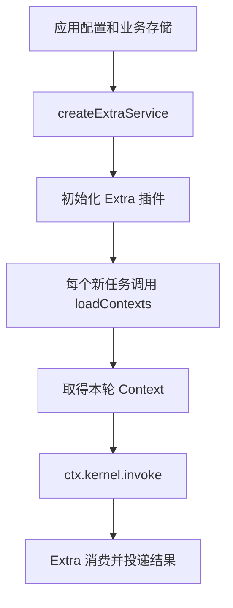
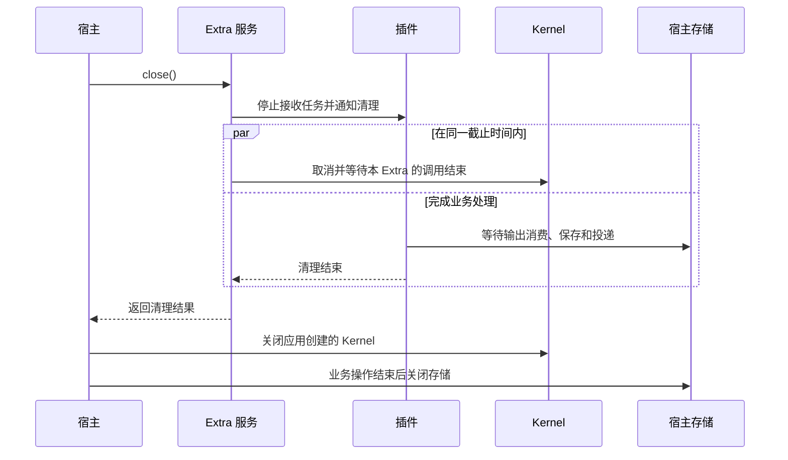

# 接入 Extra

常驻 POSIX Kernel 端点为 `<home>/executor-kernel.sock`；Windows 保持既有 Home hash 命名管道。替换旧 Kernel 前按[停止、升级、重启流程](./kernel-endpoint-upgrade.md)操作，并同步升级 attach 客户端与独立 Extra。

CLI 首选 `<extra> configure` 配置核心参数，或 `<extra> extraset` 导入完整 JSON 声明；用法、去重与重启语义见 [Extra 自有命令](extra-commands.md)。`extraset`/`extraget` 用于进阶的手写完整 JSON 声明。

[English](../../en/guides/extras.md) | [文档目录](../README.md)

Extra 用于把业务系统接到 Kernel。例如，IM Extra 接收聊天消息、准备调用参数、调用 Kernel，再把 Agent 回复发回聊天。直接使用 SDK 调用 Kernel 时，不需要 Extra。

从 `@mininglamp-oss/octo-runtime/host` 导入 `createExtraService`，传入以下参数：

- `home`：宿主已准备的绝对 Runtime Home 目录。
- `endpoint`：已有 Kernel 的地址。Extra 连接这个服务，不会替应用启动 Kernel。
- `module`：Extra 模块，例如 Channel Gateway、企业微信或 WebUI。
- `config`：该模块需要的 JSON 配置。
- `dependencies`：应用提供给模块的函数，例如读取 Context 或创建会话存储。

然后调用服务的 `initialize()` 启动，使用 `status()` 查看状态，退出时调用 `close()`。内置模块的导入路径为 `/extras/channel-gateway`、`/extras/channel-wecom` 和 `/extras/webui`，均位于主包下；各模块的 `/config-schema.json` 子路径提供配置 Schema。

## 连接 Channel Gateway

先按 [SDK 接入](../getting-started/sdk.md)原生创建 Kernel，并准备 Codex Provider。主进程装配方式见该页的 ChannelGateway 章节；[gateway.mts](../../examples/gateway.mts) 另展示使用公开 `/host` 和 `/extras/channel-gateway` 入口的完整可运行宿主例子，可放在自己的消费工程中运行。

在示例宿主的运行环境中准备以下变量；这些不是新增的 Runtime 配置字段：

| 变量 | 宿主提供的值 |
| --- | --- |
| `RUNTIME_HOME` | 宿主已准备的绝对 Runtime Home 目录 |
| `KERNEL_ENDPOINT` | 已有 Kernel 的 socket 或 Named Pipe 地址，取得方式见 SDK 入门 |
| `GATEWAY_API_URL` | 使用的 Octo IM API 基础地址 |
| `GATEWAY_BOT_ID` | 在该服务获授权的 Bot 身份 |
| `GATEWAY_BOT_TOKEN` | 从宿主受保护运行环境取得的 Bot 凭据 |
| `GATEWAY_WORKDIR` | 已存在的 Codex 执行目录绝对路径 |

共享文件包含完整的 `config: { bots: [...] }`，包括 `api_url`、`bot_id`、`bf_token` 和 `adapter: { adapter_type: "codex", workdir }`。缺少环境变量时在初始化前报错，不打印凭据。应用可以从自己的配置源准备相同值。

在同一目录创建 `instructions.txt`，写入简短指令，例如 `Answer concisely.`，然后执行：

```sh
node gateway.mts instructions.txt
```

示例初始化 Extra，打印生命周期阶段和 Kernel 可用性，等待 Ctrl+C 后关闭并检查 `complete`。初始化成功不代表 Bot 已连接或消息已送达；在 Octo IM 中向 Bot 发消息并观察回复，才能验证这条路径。关闭示例不关闭借用的 Kernel。会话默认保存在内存中，仅在业务需要时增加应用存储。

可运行入口使用异步文件 loader。同一文件也导出两种 loader，供应用装配：

```ts
import { createGatewayExample, synchronousContexts, asynchronousContexts } from "./gateway.mts";

let instructions = "Answer concisely.";
const syncLoader = synchronousContexts(() => instructions);
const asyncLoader = asynchronousContexts("instructions.txt");
const extra = createGatewayExample(process.env, asyncLoader);
```

最后一个参数选择 `asyncLoader` 或 `syncLoader`。同步实现返回 `ContextItem[]`，异步实现返回 Promise，并将取消信号传给文件 IO。两者构造带 `payload.entries` 的 `octo.control/instructions`，不使用保留的 `extra.im` 命名空间。应用仍需按可运行文件中的方式初始化、关闭 `extra`。修改文件或同步闭包读取的变量，下一轮即可取得新内容，无需重连；更换配置或函数引用仍需关闭并重新创建整个 Extra。

## 仅 Provider 使用代理

在对应 Bot 的 `context.items` 中配置 `octo.execution/envs`，可向本轮 Provider 子进程注入代理变量，不修改 Extra 的进程环境。完整声明、导入重启步骤、非 TUN 边界及 OpenClaw 例外见 [Harness 的 Gateway 代理指南](harnesses/channel-gateway.md)。不要在宿主全局 export 代理来实现此隔离。

## 每轮加载业务数据



Channel Gateway 支持通过 `GatewayDependencies.loadContexts(config, {signal})` 加载背景资料。该函数可同步或异步返回 `readonly ContextItem[]`。Gateway 每接收一个可执行任务就调用一次，因此应用数据变化后，下一轮可以读取最新内容，无需重启 Extra。

加载结果会与静态 Context 合并。同一 `namespace` 和 `name` 的动态项替换整个静态项，包括其 `payload`；不会逐字段合并。这是 Channel Gateway 的行为，直接调用 Kernel 时不会自动执行这一步。

返回 `[]` 会保留静态项。抛错、Promise 拒绝、超时或无效 Context 会使本轮准备失败；Gateway 不会沿用上一轮的动态数据。

`extra.im` 整个命名空间由 Octo Gateway 和 WeCom 对应的 Channel Extra 专属管理。渠道构造 Context 时忽略宿主静态配置和 `loadContexts` 返回的全部 `extra.im` 项，即使本轮没有生成同名项也不透传。误配仅记录忽略数量的 warning，不影响后续 AgentRun。宿主业务材料应使用其他命名空间；渠道规则如需外部更新，由渠道内部按业务合同读取并构造，本次未新增外部规则源接口。全局 `octo.control/instructions` 保留下述指令组合规则；冻结重试保留渠道已生成的完整快照。权威约束见 [Channel 规则](../../../.octospec/rules/channel-integration.md)。

取得宿主本轮有效 Context 后，Octo Gateway 在稳定规则刷新轮将默认英文 mention 指令追加到 `octo.control/instructions.payload.entries`：`entries = [...hostEffectiveEntries, ...gatewayDefaultEntries]`。通过 CLI `extraset` 配置的指令属于宿主，在前保留。两个列表各自保序、保留重复项，最终只有一个 instructions item。不修改宿主输入、不累计上一轮结果。同代次卡片重试完整复用冻结 Context 和产物交付策略，不能再次追加默认项，也不重新读取宿主数据或历史。这一步不改变宿主静态/动态替换、公共 Context 合并或其他 Extra 的行为。

Gateway 默认等待加载完成最多 5 秒，同时最多允许 8 个尚未结束的加载操作，可配置到 32 个。返回值最多 32 项，序列化后最多 64 KiB。等待超时不代表底层操作已停止；该操作实际结束前仍占用并发名额。访问数据库时也要注意：仅将同步操作包进 `async` 函数，并不能避免阻塞事件循环。

Gateway 默认指令也计入最终调用的 Context 预算。宿主返回达到上限的材料，并不代表已为 Gateway 追加项预留容量。预算不足时，Gateway 可以省略自动辅助材料；无法满足预算则报错，不静默丢弃默认指令或显式宿主项。

## Octo 点名与 Bot 交接

当前用户明确要求通知真人或向当前群的 Bot 交接任务时，模型确认目标的真实 UID，在成功 final 普通正文中输出 `@[uid:displayName]`。Gateway 核验当前成员及明确的真人标记（`robot=0/false`）或 Bot 标记（`robot=1/true`），沿原回复连接发送可读正文及原生 `mention.uids/entities`。普通 `@名字` 不产生通知。无法确认的目标退为纯文本；代码、引用示例、进度、thinking 和失败回复不转换。该能力不开放广播、CLI 重复发送或自行发起 Bot 调用。

`allowed_sender_ids` 省略时，DM 沿用平台消息准入/访问策略，群聊和话题不增加发送者限制；owner、其他用户和其他 Bot 均可按 Space、群启停/范围和原生 mention 规则触发。显式名单仅允许列出的发送者，owner 不隐式补入；`[]` 拒绝全部，`null` 非法。Gateway 不维护另一套好友名单，也不另行实施仅好友可访问的策略。卡片控制仍须匹配原任务发起者、Space、原卡片消息和频道地址。

Gateway 在命令处理、Context 准备和 AgentRun 调度前拒绝自身消息，包括自己 @ 自己和 AI 广播，即使自己的 UID 在 `allowed_sender_ids` 中也不能绕过。私聊、群和话题一致。

Bot 配置 `stable_context_refresh_interval_turns` 是正安全整数，默认 30。稳定 `extra.im/mention-instructions`、`artifact-delivery`、`history-instructions` 在第 1、N、2N…轮进入普通模型 Context；新 Provider 会话也携带完整规则，因此 Codex、Claude Code、OpenClaw 续聊均能收到周期刷新。reset/new 重置计数，控制命令、准备失败、工具步骤、自动重试和同代次卡片重试不计轮；刷新执行失败则下次补带。宿主自定义 session store 必须保留 binding 的可选 `stableContext` 状态。群/话题规则每轮核验版本，变化或刷新轮重新携带。

每条真实入站消息独立提供简短 `extra.im/message-trigger` JSON，guidance 只用一句短英文解释字段。`conversation` 标明私聊/群/子区及群、子区名称和 ID；`sender` 提供发起者 UID、姓名和 `human`/`bot`/`unknown` 类型；`recipient` 标明当前 Bot；`sentAt` 为原消息时刻的系统时区时间及显式偏移；`mentions` 保存真实 @ 目标和广播标记。名称和身份由当前 Bot 的只读 API 查询，共用 5 秒补充信息预算；名称/时间查不到为 `null`，类型未知为 `unknown`，不从正文或 UID 后缀猜测。actor 与被 @ 对象分别记录，不依赖稳定规则刷新。历史和历史缺口仍按需装配，其固定阅读规则已移入稳定项。产物交付始终使用有效策略，不因普通轮省略说明而关闭。提示使用真实换行；完整 mention 规则保留 `[OCTO_CHANNEL_MENTION_RULES_V1]` 边界，要求模型在摘要时保留，但不保证模型一定遵守。周期刷新接受轮间可能遗忘的边界，不新增 compaction 监听、压缩豁免或旧 session 升级兼容流程。会话边界见[背景资料与会话](context-and-sessions.md)。

## 保存会话

历史消息的 `sentAt` 使用原消息时刻的系统时区时间，以带显式偏移的 ISO 8601 表示，例如 `2026-10-29T13:36:53.000+08:00`。引用、转发同样保留各自时间，缺失或无效时为 null，不以处理时间代替；截短正文保留时间，时间计入既有序列化历史预算。

`message-trigger` 中 `conversation.id` 为原始频道 ID，`conversation.type` 固定为 `dm`、`group`、`group_topic`。子区在此保留完整频道 ID，`conversation.group.id` 与 `conversation.topic.id` 分别标明父群与子区。

Gateway 将已确认的用户/Bot 名称与身份类型缓存在内存中，按 API、Bot、Space 隔离，固定十分钟过期，每个 Bot 最多 2,000 项；读取不续期，失败或缺失结果不缓存。名称更新可能延迟至过期；缓存不用于成员权限或发送 mention 的授权。可选信息补全失败不阻断 AgentRun，不重试或改用另一查询接口；用户取消仍会取消准备过程。

自动历史采用 `messages: [{uid, username, sentAt, content}]`，从旧到新排列，同一发送者连续发言仍分别保留。所有正文都有类型，包括 `content: {type: "text", text: "..."}`。回复分开保留引用与回复正文，转发保留嵌套消息，富文本保留有序块。图片、文件和文档引用标为 `read: false`，准备历史不下载资源正文。完整数组序列化后最多 20 条、8,000 个 Unicode 码点；截短或省略正文会明确标注，嵌套也有限制。模型输入不再单独携带自动 `history-gap`：历史不完整、读取失败或被省略时，在 `history` 的 `messages` 旁附一句简短英文 `note`；失败时消息列表可为空，正常历史不加说明。读取游标与交接证据留在 Gateway 内部。

数组预算包含身份、时间、JSON 结构及转义。主历史与 fresh fallback 恢复补充共用同一份最多 20 条/8000 码点窗口；首轮和连续性未知保留自身 Bot 消息，确认正常接续时才可省略已由 assistant 覆盖的具体输出。详见 [Gateway 历史选择与恢复](context-and-sessions.md)。

最终交付物中的本地 Markdown 路径统一按 Gateway 实际文件系统尝试读取，包含 OpenClaw preset，无需新增配置，不默认限制到工作区。原 `artifact_delivery.allowed_roots` 若显式配置仍限制目录，空列表拒绝全部。文件缺失或不可读按实际失败报告，不能由 Agent 来源推断远程存储。

通过 `GatewayDependencies.createSessionStore(botConfig)` 为每个 Bot 提供独立的会话存储。不提供该函数时，Gateway 使用有容量限制的内存存储。

应用可以自行选择存储实现；Runtime 不依赖 SQLite，也不负责应用数据库的表结构和迁移。关闭数据库前，要先等待 Extra 的输出消费和存储操作结束。详细的业务配置与存储实现见现有中文 [Gateway 接入指南](../../../SDK_CHANNEL_GATEWAY_GUIDE.md)。

## 开发自己的 Extra

> **交互兼容性要求：登记或渲染控件前，必须按 `interaction.requested.payload.delivery` 分流。** async 是可选的旁路补充，旧同步处理器不会自动兼容。没有专门接入时，应成对忽略 requested/resolved，继续读流和展示正文，保留同步问答与审批。接入异步表单则必须实现结构化整批回答和完整生命周期，详见[Extra 必须明确选择处理方式](../reference/output-and-control.md)。当前三个内置 Extra 均忽略 async 控制。

插件入口的形式为 `extra(context, jsonConfig)(dependencies)`。配置值放在 `jsonConfig`，应用函数放在 `dependencies`。插件与这些函数运行在同一进程中。

插件通过 `ctx.kernel.invoke` 调用共享 Kernel，通过 `ctx.onDispose` 注册清理函数，通过 `ctx.onStatus` 提供业务状态，通过 `ctx.log` 记录诊断信息。应用通过这些公开接口管理插件，不需要访问插件内部对象或另外建立执行转发接口。

## 通过宿主依赖使用 Provider 或外部服务

查询模型目录或向外部服务传递业务数据与 Kernel 无关。宿主可以选择两种方式：

1. **宿主直接调用** Provider 或外部服务，无需 Extra。
2. **Extra 调用宿主注入的 dependency**，由该函数查询 Provider 或向外部服务传递数据。

Extra 是可选路径。用户可以自行实现 lambda，也可复用 Provider 集成模块的函数；不要求 Provider 新增扩展机制，两种方式都不经过 Kernel。

例如，模型选项 Extra 可以调用宿主注入的目录查询函数，获得所选官方服务、代理站或自定义 endpoint 的选项；需要将目录或业务结果发布到外部服务时，则调用对应的发布函数。查询和发布属于该 Extra 的业务依赖，不是 Kernel 的统一模型目录接口。Provider 可以提供集成实现，不需要将 Kernel 所使用的 Adapter 实例暴露给 Extra。

具体 Extra 必须定义并消费对应依赖；入口存在时，用户只需提供实现。宿主选择实现并封装配置、凭据和授权，Extra 按业务合同调用并处理结果、错误和取消。函数在 Extra 所在进程中运行，可以通过网络访问外部服务，不放进 JSON，也不通过 Kernel IPC 传输；框架不自动发现 Provider 函数或代替业务决定发送、重试与确认语义。现有依赖关闭及实际在途管理继续生效，`signal` 需要调用方显式传递。

这使模型目录的责任保持在 Provider/宿主侧，同时允许 Extra 使用实际业务能力。背景见[模型目录与选模归属](../concepts/architecture.md)，工程约束见 [Extra 规则](../../../.octospec/rules/extras.md)。

## 关闭 Extra



调用 `close()` 后，Extra 停止新调用，通知插件清理，并取消、等待本 Extra 已提交的调用。这些工作共用默认 4 秒的关闭期限；如果上层指定的截止时间更早，就使用更早的时间。

清理期间，插件仍可调用应用依赖函数完成保存和投递。插件清理结束或期限到达后，不再允许发起新的依赖调用。已经开始的函数不能被强制停止，服务会继续记录尚未结束的操作。

检查 `close()` 返回的 `complete`、`errors` 和 `pendingResources`。`complete=false` 表示还有未完成或未确认释放的资源，不能直接按“全部已关闭”处理。数据库仍由应用管理，SDK 不会自动关闭它。

关闭一个 Extra 不会关闭共享 Kernel，也不会停止其他 Extra 的调用。查看状态时，`phase` 表示 Extra 服务的生命周期阶段，`kernel_available` 表示 Kernel 当前是否可执行，`plugin` 则是插件报告的业务状态。确认 Bot 或 Provider 是否在线，需要查看对应状态和连接结果。

来源：[Extra API](../../../packages/octo-runtime-host-sdk/src/extras.ts)、[service](../../../packages/octo-runtime-host-sdk/src/extra-service.ts)、[Gateway 入口](../../../packages/octo-runtime-extra-channel-gateway/src/extra.ts)、[指令组合](../../../packages/octo-runtime-extra-channel-gateway/src/execution/dispatcher.ts)、[mention 规则与转换](../../../packages/octo-runtime-extra-channel-gateway/src/transport/mentions.ts)、[消息准入](../../../packages/octo-runtime-extra-channel-gateway/src/transport/normalize.ts)。
